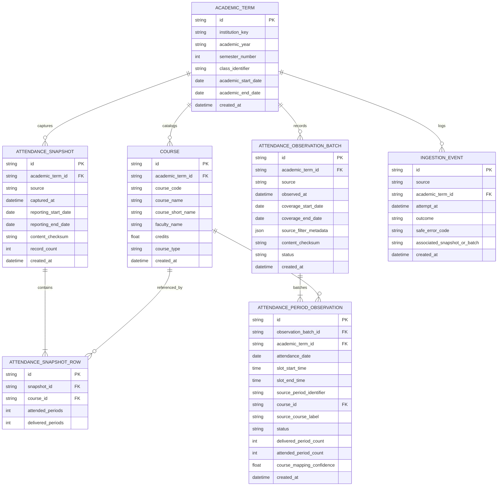

# AttendPlan F1 Database Design Specification

## 1. Storage Engine & Operational Parameters
AttendPlan employs an embedded, local-first relational database architecture backed by SQLite 3 via SQLAlchemy 2.0 and Alembic.

- **Primary Database Path**: `%LOCALAPPDATA%/AttendPlan/attendplan.sqlite3` (falls back to `~/.attendplan/attendplan.sqlite3` on POSIX environments or when `LOCALAPPDATA` is undefined).
- **Environment Override**: `ATTENDPLAN_DB_PATH`.
- **Journal Mode**: Write-Ahead Logging (`PRAGMA journal_mode=WAL`) for concurrent reader performance.
- **Synchronous Mode**: `PRAGMA synchronous=NORMAL`.
- **Referential Integrity**: Explicitly enforced on every connection pool initialization via `PRAGMA foreign_keys=ON`.
- **Network Boundaries**: Embedded filesystem strictly; zero remote database socket exposures.

---

## 2. Relational Schema & Entity Relationship Model

---

## 3. Data Dictionary & Constraints

### 3.1 `academic_terms`
Represents an institutional university term (e.g., Academic Year 2026-2027, Semester 5).
- `id` (VARCHAR(36), PK): UUID v4.
- `institution_key` (VARCHAR(32), NOT NULL, default 'mrei'): Institutional domain tenant identifier.
- `academic_year` (VARCHAR(16), NOT NULL): e.g., `'2026-2027'`.
- `semester_number` (INTEGER, NOT NULL): 1 through 12.
- `class_identifier` (VARCHAR(64), NULLABLE): Student cohort/section identifier.
- `academic_start_date` / `academic_end_date` (DATE, NULLABLE): Boundary dates of the semester.
- `created_at` (DATETIME, NOT NULL): Record creation timestamp.
- **Constraints**:
  - `uq_term_identity`: `UNIQUE(institution_key, academic_year, semester_number, class_identifier)`.

### 3.2 `courses`
Represents a semester-specific course catalog entry. Courses in different semesters remain strictly isolated, even if sharing identical course codes.
- `id` (VARCHAR(36), PK): UUID v4.
- `academic_term_id` (VARCHAR(36), FK -> `academic_terms.id`, ON DELETE CASCADE, NOT NULL).
- `course_code` (VARCHAR(32), NOT NULL): e.g., `'CSH301C'`.
- `course_name` (VARCHAR(256), NOT NULL): Official title.
- `course_short_name` (VARCHAR(64), NULLABLE): e.g., `'CAOR - PP'`.
- `faculty_name` (VARCHAR(128), NULLABLE): Assigned instructor.
- `credits` (FLOAT, default 1.0, NOT NULL).
- `course_type` (VARCHAR(16), default 'THEORY', NOT NULL): `THEORY`, `LAB`, `TUTORIAL`, `OTHER`, `UNKNOWN`.
- **Constraints**:
  - `uq_course_per_term`: `UNIQUE(academic_term_id, course_code)`.

### 3.3 `attendance_snapshots` & `attendance_snapshot_rows`
Represents an immutable capture of subject-wise attendance at a given point in time.
- **Check Constraints**:
  - `ck_snapshot_row_counts`: `CHECK (attended_periods >= 0 AND delivered_periods >= 0 AND attended_periods <= delivered_periods)`.
- **Uniqueness & Deduplication**:
  - `uq_snapshot_term_checksum`: `UNIQUE(academic_term_id, content_checksum)`.
  - Content checksum is calculated via canonical SHA-256 independent of row presentation order.
- **Referential Integrity**:
  - `snapshot_id` references `attendance_snapshots.id` ON DELETE CASCADE.
  - `course_id` references `courses.id` ON DELETE RESTRICT.

### 3.4 `attendance_observation_batches` & `attendance_period_observations`
Represents date-wise timetable observations (e.g., extracted from `myattendance.php`).
- **Check Constraints**:
  - `ck_period_counts`: `CHECK (attended_period_count >= 0 AND delivered_period_count >= 0 AND attended_period_count <= delivered_period_count)`.
- **Period Accounting**:
  - Multi-period lab sessions record `delivered_period_count=2, attended_period_count=2` (or `0` if absent).
  - Unscheduled/empty matrix cells record `status='NO_CLASS', delivered_period_count=0, attended_period_count=0`.
- **Unmapped Observations**:
  - When course code cannot be determined from day-wise headers, `course_id` remains `NULL`, `source_course_label` stores raw cell text, and `course_mapping_confidence=0.0`. These observations feed date-level analytics without corrupting course-level metrics.

---

## 4. Alembic Migration Architecture
- **Location**: `backend/alembic/versions/`
- **Initial Revision**: `448d5b554af1_initial_f1_schema.py`
- **SQLite Batch Alteration**: Configured with `render_as_batch=True` in `alembic/env.py` to enable table recreations and foreign key migrations on SQLite.
- **Verification Guarantee**: Verified via automated test `test_migration.py` testing clean upgrades to `head`, clean downgrades to `base`, and idempotent re-upgrades.
