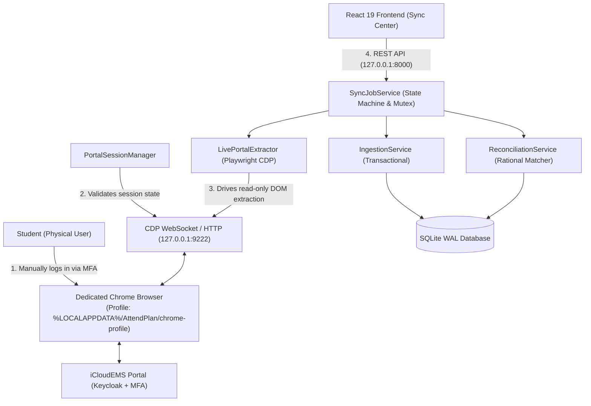

# AttendPlan — Live Portal Synchronization Architecture (F2-B)

## 1. Overview & Architectural Philosophy
AttendPlan implements reliable, privacy-preserving live attendance synchronization from the official university iCloudEMS portal (`https://mrei.icloudems.com/corecampus/index.php`).

### Non-Negotiable Boundaries:
1. **Local-First & Loopback-Only**:
   - The FastAPI backend binds exclusively to `127.0.0.1:8000`.
   - Chrome Remote Debugging Protocol (CDP) binds strictly to `127.0.0.1:9222`.
   - No ports or debugging sockets are ever exposed to the local network (LAN) or public interfaces.
2. **Zero Automated Login & Zero Credential Persistence**:
   - The student authenticates manually in a dedicated Chrome profile.
   - We never request, capture, log, or persist passwords, Keycloak tokens, TOTP seeds, or session cookies.
   - No session replay or credential automation is ever attempted.
3. **Strictly Read-Only Automation**:
   - Interactions with iCloudEMS are strictly read-only navigation and table extraction.
   - We never perform state-changing form submissions (e.g. feedback, enrollment, grading) or bypass anti-tamper protections.
4. **Offline & Live Separation**:
   - Live synchronization is explicitly distinguished from sample/historical fixture playback.
   - Offline tests use sanitized, PII-scrubbed fixtures.

---

## 2. Component Architecture



---

## 3. Dedicated Browser Profile & CDP Attachment
To avoid interfering with the student's normal browsing activity and ensure cookie isolation:
- **Profile Directory**: `C:\Users\<user>\AppData\Local\AttendPlan\chrome-profile`
- **Launch Command**:
  ```powershell
  cmd /c "`"C:\Program Files\Google\Chrome\Application\chrome.exe`" --remote-debugging-port=9222 --remote-debugging-address=127.0.0.1 --user-data-dir=`"C:\Users\<user>\AppData\Local\AttendPlan\chrome-profile`" --no-first-run --no-default-browser-check https://mrei.icloudems.com/corecampus/index.php"
  ```
- **Connection Strategy**:
  `LivePortalExtractor` connects via `playwright.chromium.connect_over_cdp("http://127.0.0.1:9222")`. This attaches to the active page without restarting the browser or losing active session cookies.

---

## 4. Extraction Pipelines

### A. Gate 2: Subject-Wise Attendance (`subwise_attendace_new.php`)
1. Navigate to `subwise_attendace_new.php`.
2. Discover academic-year select options (`#academic_year` or semantic selector).
3. Select requested year (e.g. `2025-2026`).
4. Wait for dependent semester dropdown to populate (`#semester_id`).
5. Select target semester (e.g. `5`).
6. Wait for dependent class dropdown (`#class_id`).
7. Click `Search` / `Submit` button.
8. Wait for `#attendance_table` or semantic table to render.
9. Extract rows: Course Code, Course Name, Category, Attended Periods, Delivered Periods.
10. Validate:
    - $0 \le a \le d$.
    - Percentage verification: compare rational $\frac{a}{d} \times 100$ against portal-rendered string within rounding margin.
11. Return `LiveSubjectWiseExtractionResult`.

### B. Gate 3: Day-Wise Timetable Matrix (`myattendance.php`)
1. Navigate to `myattendance.php`.
2. Select Academic Year, Semester, and Class.
3. Select Month (e.g., `09` for September).
4. Verify / click `Show Course Name` checkbox if present to enable course attribution.
5. Click `Search` button.
6. Extract horizontal timetable matrix:
   - Header: Day/Date columns (e.g. `Mon 01/09`, `Tue 02/09`, ...).
   - Rows: Time slots (e.g., `08:10-09:00`, `09:00-09:50`, ...).
   - Cells: `P` (Present), `A` (Absent), or blank (`NOT_REPORTED`).
   - Extract course label if course name toggle is active.
7. Return `LiveDayWiseExtractionResult`.

---

## 5. Transactional Persistence & Deduplication
- **Subject-Wise Snapshot**:
  - Saved as `AttendanceSnapshot` linked to `AcademicTerm`.
  - Canonical checksum computed over lexicographically sorted course tuples `(code, attended, delivered)`.
  - If identical checksum exists, returns `UNCHANGED_CHECKSUM` (idempotent).
- **Day-Wise Observations Batch**:
  - Saved as `AttendancePeriodObservationBatch` with individual `AttendancePeriodObservation` rows.
  - Checksum computed over sorted `(attendance_date, time_slot, status, course_code)`.
  - Repeat syncs of the same month are safely deduplicated.

---

## 6. Concurrency Control
- A process-wide mutex `_SYNC_LOCK = threading.Lock()` guarantees that **only one live synchronization job** can drive the browser CDP session at any given time.
- Any concurrent request while a job is running receives an HTTP 409 Conflict error.
