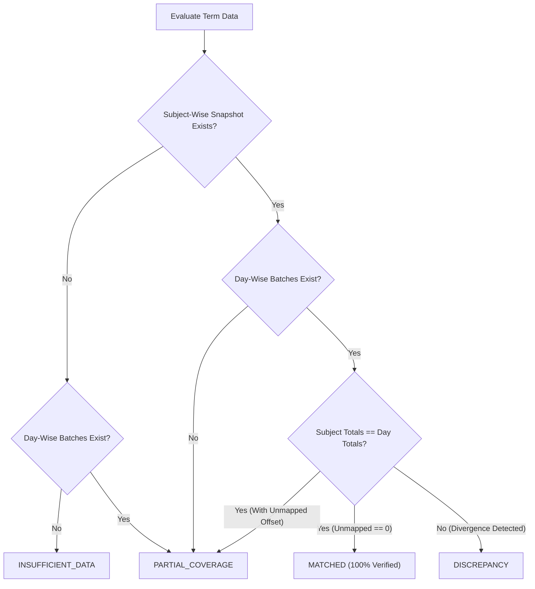

# AttendPlan F1 Source Reconciliation Specification

## 1. Architectural Motivation
In university ERP systems such as iCloudEMS, attendance data is exposed across three distinct surfaces:
1. **Subject-Wise Attendance Summary** (`subwise_attendace_new.php`): Official aggregated delivery totals per registered course.
2. **Day-Wise Timetable Matrix** (`myattendance.php`): Fine-grained lecture slot observations indexed by calendar date.
3. **Overall Attendance Summary** (`allSubject.php`): Candidate macro view of semester percentages.

In practice, these datasets frequently diverge due to:
- Distinct date reporting windows (e.g., subject-wise includes the entire semester to date, while day-wise was extracted for a single month).
- Faculty attendance upload delays or retroactive mark corrections.
- Laboratory period accounting discrepancies (e.g., 2-period lab blocks recorded as single meetings).
- Unmapped timetable observation slots where course codes are absent.

**Core Invariant**: AttendPlan never declares one dataset unilaterally authoritative over another. Instead, it provides rigorous mathematical reconciliation reporting.

---

## 2. Reconciliation Status Categories

The `ReconciliationService` evaluates academic terms into four deterministic states:

### State Definitions:
1. **`MATCHED`**:
   - Total attended periods match exactly: $\sum a_{\text{subject}} = \sum a_{\text{day}}$.
   - Total delivered periods match exactly: $\sum d_{\text{subject}} = \sum d_{\text{day}}$.
   - Zero unmapped observations exist.
   - Status: Complete mathematical concordance.
2. **`PARTIAL_COVERAGE`**:
   - Only one source exists (e.g., subject snapshot present, but day-wise timetable not yet imported).
   - Or day observations match only after accounting for known unmapped period slots.
3. **`DISCREPANCY`**:
   - Both sources exist, but period counts diverge beyond explainable unmapped offsets.
   - Highlights course-by-course variances with explicit $\Delta \text{attended}$ and $\Delta \text{delivered}$ flags.
4. **`INSUFFICIENT_DATA`**:
   - No records of either type exist for the term. System prevents fabricating metrics.

---

## 3. Course-by-Course Variance Reporting

For every registered course in the catalog, the reconciliation engine computes:
$$\Delta \text{attended}_i = a_{\text{day}, i} - a_{\text{subject}, i}$$
$$\Delta \text{delivered}_i = d_{\text{day}, i} - d_{\text{subject}, i}$$

Each item is classified:
- `MATCHED`: $\Delta \text{attended} = 0 \land \Delta \text{delivered} = 0$.
- `DISCREPANCY`: Count divergence detected.
- `NO_DAY_DATA`: Course exists in subject snapshot but has no linked day-wise observations.
- `UNMAPPED_ONLY`: Periods observed on timetable but cannot be attributed to a registered course.
