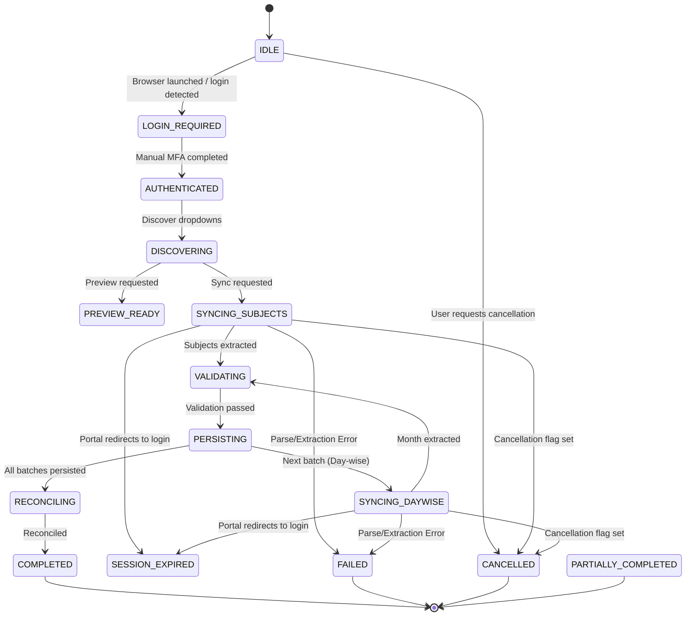

# AttendPlan — Synchronization State Machine Specification

## 1. Overview
The synchronization engine tracks all portal sync sessions via a formal, persistent finite-state machine backed by the `sync_jobs` SQLite table.

---

## 2. States & Semantics

| State | Type | Description |
|---|---|---|
| `IDLE` | Transient | Job created, queued, or awaiting executor assignment. |
| `LOGIN_REQUIRED` | Blocked | User needs to perform Keycloak/Google Authenticator login in Chrome. |
| `AUTHENTICATED` | Operational | Valid student portal session confirmed via active URL / dashboard check. |
| `DISCOVERING` | Active | Discovering academic years, semesters, or classes from select elements. |
| `PREVIEW_READY` | Ready | Data extracted and validated; ready for user inspection before saving. |
| `SYNCING_SUBJECTS` | Active | Extracting and parsing subject-wise attendance roster from `subwise_attendace_new.php`. |
| `SYNCING_DAYWISE` | Active | Extracting and parsing timetable matrix from `myattendance.php`. |
| `VALIDATING` | Active | Mathematical verification: $0 \le a \le d$, rational percentages, checksum calculation. |
| `PERSISTING` | Active | Transactional write of `AttendanceSnapshot` or `AttendancePeriodObservationBatch` to SQLite. |
| `RECONCILING` | Active | Computing cross-source reconciliation and flagging discrepancies. |
| `COMPLETED` | Terminal | Synchronization finished successfully with all requested data saved. |
| `PARTIALLY_COMPLETED` | Terminal | Some batches persisted, but one or more sub-tasks failed or were skipped. |
| `SESSION_EXPIRED` | Paused | Portal session timed out during execution; prior successful batches preserved. |
| `CANCELLED` | Terminal | User initiated cancellation between batches. |
| `FAILED` | Terminal | Fatal exception occurred (e.g. DOM structure mismatch, network disconnect). |

---

## 3. State Transition Diagram

---

## 4. Concurrency & Mutex Protection
To prevent race conditions, multiple simultaneous browser operations, or CDP protocol corruption:
1. `_SYNC_LOCK = threading.Lock()` guarantees exclusive access to browser automation.
2. If another job is currently active, any new sync initiation immediately returns HTTP 409 Conflict with `JobConcurrencyError`.
3. Safe cancellation checks `_cancel_requested` flags between individual month or subject batch extractions, ensuring database transactions are never interrupted mid-commit.

---

## 5. Session Expiration Recovery
If iCloudEMS logs out the user during synchronization:
1. Extractor intercepts login redirect (`index.php` or `auth/realms`).
2. Current active batch is rolled back cleanly.
3. Any previously persisted batches remain safely committed.
4. Job transitions to `SESSION_EXPIRED`.
5. Frontend alerts the user to re-authenticate in Chrome.
6. User resumes synchronization without restarting from scratch.
