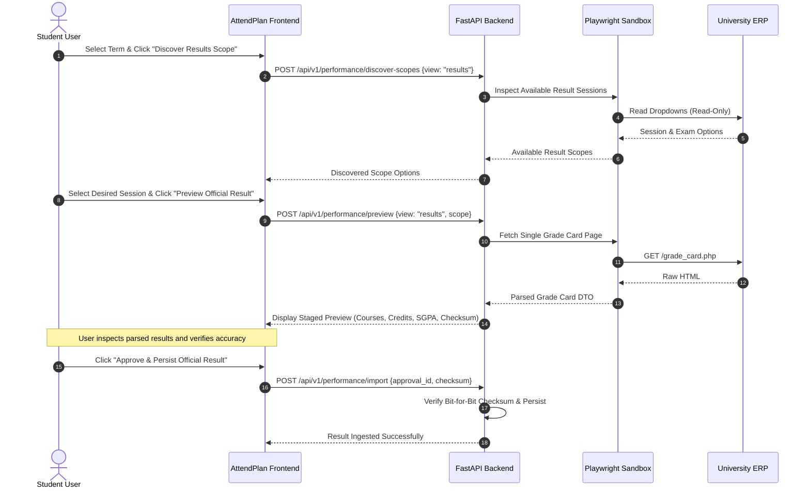

# ATTENDPLAN — OFFICIAL RESULTS REQUEST MANIFEST
**Manifest Version:** 1.1.0 (Phase E.6.1 Offline Preparation & Forensic Hardening)  
**Date:** November 2, 2026  
**Status:** DRAFT SPECIFICATION — STRICTLY OFFLINE — PENDING FUTURE USER LIVE AUTHORIZATION  
**Execution Gate:** Strictly Offline — Zero Network Calls Permitted Under This Manifest Until Explicit User Approval

---

## 1. Purpose & Guiding Principles

This manifest defines the bounded, secure, and audited operational specification for a future live discovery and potential extraction of **Official Academic Results (Data Class B)** from the university ERP portal (`mrei.icloudems.com`).

### Core Safety Principles:
1. **No Unsolicited Network Requests:** No discovery or extraction will execute without explicit, interactive user consent.
2. **Discovery Before Retrieval:** The portal's actual result navigation paths and parameter dropdowns must be inspected and verified in the live DOM before any data retrieval is attempted. Candidate paths listed here are exploratory inspection routes, not pre-confirmed endpoints.
3. **Dry-Run Preview Approval:** Any captured grade sheet payload must be displayed in a read-only preview card showing detected courses, credit totals, and GPA values before persistence into SQLite.
4. **Zero Overwrite of Prior Data:** Captured result cards will be stored with distinct `view="results"` keys, leaving all existing `view="marks"` internal assessment snapshots and the entire 3,520-observation attendance archive 100% untouched.

---

## 2. Candidate Discovery Inspection Paths

The following paths represent candidate locations in iCloudEMS to inspect for student grade sheets:

| Priority | Candidate Relative URI | Method | Candidate Function | Verification Requirement |
| :---: | :--- | :---: | :---: | :--- |
| **A** | `/corecampus/student/reportcard/myreportcard.php?exam_type=4` | `GET` / `POST` | Inspect if Type 4 (External Exam) provides end-term marks or consolidated grades | Verify column headers in DOM |
| **B** | `/corecampus/student/examination/grade_card.php` | `GET` | Inspect if official student grade sheet is rendered with SGPA/CGPA | Inspect navigation link text |
| **C** | `/corecampus/student/examination/result_card.php` | `POST` | Inspect if examination results lookup returns official credits and letter grades | Verify selector options |

---

## 3. Term-by-Term Request Scope Candidates

The candidate parameters for discovering official grade sheets for each academic term are structured as follows:

```json
{
  "request_templates": [
    {
      "term_key": "2024-2025_s1_918",
      "academic_year": "2024-2025",
      "semester_number": 1,
      "class_identifier": "918",
      "data_class": "CLASS_B_OFFICIAL_RESULTS",
      "candidate_session_ids": ["5764"],
      "publication_status": "DISCOVERY_REQUIRED",
      "retrieval_status": "NOT_FETCHED"
    },
    {
      "term_key": "2024-2025_s2_1048",
      "academic_year": "2024-2025",
      "semester_number": 2,
      "class_identifier": "1048",
      "data_class": "CLASS_B_OFFICIAL_RESULTS",
      "candidate_session_ids": ["5943"],
      "publication_status": "DISCOVERY_REQUIRED",
      "retrieval_status": "NOT_FETCHED"
    },
    {
      "term_key": "2025-2026_s3_1067",
      "academic_year": "2025-2026",
      "semester_number": 3,
      "class_identifier": "1067",
      "data_class": "CLASS_B_OFFICIAL_RESULTS",
      "candidate_session_ids": ["6161"],
      "publication_status": "DISCOVERY_REQUIRED",
      "retrieval_status": "NOT_FETCHED"
    },
    {
      "term_key": "2025-2026_s4_2508",
      "academic_year": "2025-2026",
      "semester_number": 4,
      "class_identifier": "2508",
      "data_class": "CLASS_B_OFFICIAL_RESULTS",
      "candidate_session_ids": ["6424"],
      "publication_status": "DISCOVERY_REQUIRED",
      "retrieval_status": "NOT_FETCHED"
    },
    {
      "term_key": "2026-2027_s5_2582",
      "academic_year": "2026-2027",
      "semester_number": 5,
      "class_identifier": "2582",
      "data_class": "CLASS_B_OFFICIAL_RESULTS",
      "candidate_session_ids": ["6732"],
      "publication_status": "NOT_DECLARED_BY_UNIVERSITY",
      "retrieval_status": "NOT_FETCHED",
      "note": "Skip retrieval until official end-semester examinations conclude."
    }
  ]
}
```

---

## 4. Extraction & Validation Rules

When official result extraction is executed under future authorization:
1. **DOM Table Normalization:**
   - Detect column headers case-insensitively using aliases (`ALIASES` map):
     - Course Code: `["course code", "subject code", "sub code"]`
     - Course Name: `["course name", "subject title", "subject"]`
     - Credits: `["credit", "credits", "cr"]`
     - Grade: `["grade", "letter grade"]`
     - Grade Point: `["grade point", "gp", "points"]`
     - Result Status: `["result", "status", "remarks"]`
2. **GPA Header Extraction:**
   - Parse SGPA and CGPA strictly from authoritative result summary labels:
     - Regex: `(?:SGPA|S\.G\.P\.A\.?)\s*[:=]\s*(\d+(?:\.\d+)?)`
     - Regex: `(?:CGPA|C\.G\.P\.A\.?)\s*[:=]\s*(\d+(?:\.\d+)?)`
   - Bound validation: $0.0 \le \text{SGPA} \le 10.0$ and $0.0 \le \text{CGPA} \le 10.0$.
3. **Sanitization Protocol:**
   - Any student roll number, name, parentage, date of birth, or college registration number must be stripped before checksum calculation and persistence.

---

## 5. User Approval Handshake Workflow


