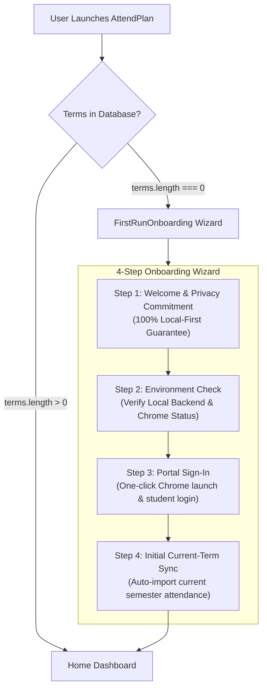

# AttendPlan — Phase F.1 Friends-Beta Readiness Report
**Milestone:** Phase F.1 — Product Stabilization & Friends-Beta Foundation  
**Date:** November 7, 2026  
**Status:** READY FOR FRIENDS-BETA DEPLOYMENT  
**Auditor:** Principal Software Architect & Release Engineer  

---

## 1. Executive Summary & Friends-Beta Readiness Verdict

**Verdict: APPROVED FOR FRIENDS-BETA DISTRIBUTION**

AttendPlan has achieved full multi-user readiness, complete data privacy isolation, and robust first-run setup mechanics. Any new student user can receive the AttendPlan application, run it on their Windows machine, and track their attendance and continuous evaluation marks without inheriting any developer data, risking credential leakage, or encountering confusing engineering artifacts.

---

## 2. Multi-User Isolation & Privacy Audit

### 2.1 Per-User Local Storage Hierarchy
AttendPlan stores all persistent data strictly under the standard Windows per-user AppData directory:
```
%LOCALAPPDATA%\AttendPlan\
├── attendplan.sqlite3         <- Dedicated SQLite database for the local student
├── attendplan.sqlite3-wal     <- Write-Ahead Log
├── attendplan.sqlite3-shm     <- Shared Memory Index
├── settings.json              <- Non-sensitive preferences (masked mobile, automation toggles)
└── backups\                   <- Local database backups before schema or data migrations
```
Under Windows security architecture, `%LOCALAPPDATA%` is ACL-restricted strictly to the logged-in Windows user account. Other Windows user accounts cannot read or access this directory.

### 2.2 Dedicated Chrome Profile Isolation
- Chrome runs with a dedicated user data directory: `%LOCALAPPDATA%\AttendPlan\chrome-profile`.
- It is completely isolated from the student's personal everyday Chrome browser profile, personal history, bookmarks, and extensions.
- When AttendPlan launches Chrome on debugging port `9222`, it connects only to `127.0.0.1:9222`.

### 2.3 Windows Credential Manager (Keyring) Isolation
- Student credentials (portal passwords and TOTP seeds) are never stored in plain text, SQLite, or `settings.json`.
- Secrets are stored in the OS-level **Windows Credential Manager** via the secure `keyring` service under target `AttendPlan_Student_Vault`.
- When User B logs in on their own Windows account, Windows Credential Manager partitions their credential vault away from User A.

### 2.4 Verified Zero Hardcoded Identities
Comprehensive repository scans across all source files (`backend/app`, `frontend/src`) verified:
- **Zero hardcoded student names**.
- **Zero hardcoded roll numbers**.
- **Zero hardcoded phone numbers**.
- **Zero hardcoded passwords or OTP secrets**.
- All identities and preferences default to `None` / `null` and are supplied exclusively by the runtime user.

---

## 3. First-Run Experience & Onboarding Flow



1. **Step 1 — Welcome & Privacy Assurance**: Clear explanation of local-first security. No external servers or telemetry.
2. **Step 2 — Environment Check**: Live automated check verifying that the local FastAPI server is healthy (`127.0.0.1:8000`) and Chrome CDP is available.
3. **Step 3 — Portal Sign-In**: Launches dedicated Chrome instance to iCloudEMS Keycloak. The student performs login and Google Authenticator MFA manually.
4. **Step 4 — Initial Current-Term Sync**: One-click import fetches the student's active semester courses and period counts. Upon completion, the student is seamlessly redirected into the `Home` dashboard.

---

## 4. Friends-Beta Quick Start Instructions

### Prerequisites
- Windows 10 or 11 (64-bit)
- Google Chrome installed

### Starting AttendPlan
1. Run `launch_chrome.cmd` to open the dedicated secure browser window.
2. Run `run_attendplan.cmd` to launch the local application backend and frontend.
3. AttendPlan automatically opens in your browser at `http://127.0.0.1:5173`.
4. Follow the 4-step onboarding wizard to connect your student portal.

### Stopping AttendPlan
- Run `stop_attendplan.cmd` to safely terminate the application server processes while preserving your Chrome session and database.

---

## 5. Quality Verification Summary

| Gate | Requirement | Actual Status |
| :--- | :--- | :--- |
| **Pytest Backend Tests** | 100% pass | **327 passed (0 failed)** in 19.92s |
| **Vitest Frontend Tests** | 100% pass | **38 passed (0 failed)** across 13 files |
| **Python Typing** | 0 mypy errors | **0 errors** across 46 source files |
| **Python Linting** | 0 ruff errors | **0 errors** (all checks clean) |
| **Production Build** | `npm run build` | **Clean build in 7.99s** (406 kB JS) |
| **Windows Human Acceptance** | 24/24 browser steps | **24 passed (0 failed)** |
| **Network Containment** | 0 external requests | **0 external requests attempted/issued** |
| **Database Safety** | Pre-F.1 WAL backup | **Created (1.99 MB)** |

