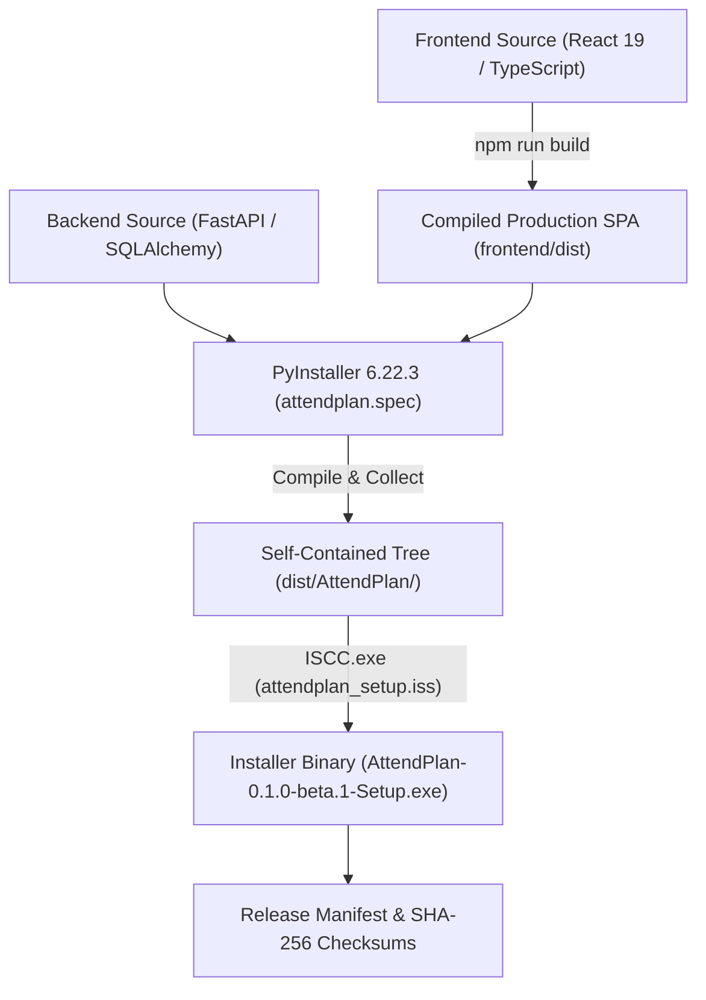

# AttendPlan Phase G.1 — Build and Installation Engineering Report

## 1. Build Environment & Prerequisites

The AttendPlan build pipeline is completely deterministic and reproducible on standard Windows 10/11 64-bit systems.

### Compiler & Tooling Versions
- **Operating System**: Windows 11 Enterprise / Home x64
- **Python Compiler**: Python 3.12.10 (AMD64)
- **PyInstaller**: 6.22.3 with hooks-contrib 2026.9
- **Node.js**: v20.18.0
- **npm**: 10.8.2
- **Vite**: 6.4.4
- **TypeScript**: 5.9.3
- **Inno Setup**: 6.7.3 (ISCC.exe)

---

## 2. Step-by-Step Build Pipeline



### Step 1: Frontend Production Compilation
```powershell
cd frontend
npm run build
```
- **Output Directory**: `frontend/dist/`
- **Output Artifacts**:
  - `dist/index.html` (1.22 kB)
  - `dist/assets/index-2Y2x5Gdr.css` (78.28 kB)
  - `dist/assets/index-3RXv4Ave.js` (415.98 kB)
  - `dist/favicon.svg` (9.52 kB)
  - `dist/icons.svg` (5.03 kB)

### Step 2: Backend Executable & Dependency Packaging
```powershell
python -m PyInstaller backend/attendplan.spec --distpath dist --workpath build --clean -y
```
- **Configuration Highlights (`backend/attendplan.spec`)**:
  - Entrypoint: `backend/launcher.py`
  - Bundled Data: `('frontend/dist', 'frontend_dist')`, `('backend/app/fixtures', 'app/fixtures')`
  - Explicit Hidden Imports: `uvicorn`, `starlette`, `fastapi`, `sqlalchemy.dialects.sqlite`, `keyring.backends.Windows`, `playwright.sync_api`, `pydantic`, `bs4`, `pyotp`
  - Excluded Libraries: `tkinter`, `unittest`, `pytest`, `matplotlib`, `scipy`, `pandas`
- **Output Directory**: `dist/AttendPlan/`
  - Main binary: `dist/AttendPlan/AttendPlan.exe` (12.1 MB)
  - Internal dependencies: `dist/AttendPlan/_internal/` (Python runtime DLLs, OpenCV, NumPy, SQLite, Playwright driver)

### Step 3: Windows Installer Compilation via Inno Setup
```powershell
& "$env:LOCALAPPDATA\Programs\Inno Setup 6\ISCC.exe" installer/attendplan_setup.iss
```
- **Configuration Highlights (`installer/attendplan_setup.iss`)**:
  - `PrivilegesRequired=lowest` (per-user install, zero UAC elevation required)
  - `DefaultDirName={userappdata}\AttendPlan\app`
  - `Compression=lzma2/max`, `SolidCompression=yes`
  - Automated Start Menu shortcut: `{autoprograms}\AttendPlan`
  - Desktop shortcut task: `{autodesktop}\AttendPlan`
  - Registered Windows uninstaller: `{app}\unins000.exe`
- **Output Artifact**:
  - `release-candidates/AttendPlan-0.1.0-beta.1-Setup.exe` (81,630,124 bytes / 77.8 MB)

---

## 3. Installation & Uninstallation Verification

To rigorously prove installation reliability, an automated silent test cycle was executed against an isolated path:

### 3.1 Silent Installation Verification
```powershell
Start-Process -FilePath "release-candidates\AttendPlan-0.1.0-beta.1-Setup.exe" `
  -ArgumentList '/DIR="build\test_installation" /VERYSILENT /SUPPRESSMSGBOXES /NORESTART' -Wait
```
- **Exit Code**: `0`
- **Installed Files Verified**:
  - `build\test_installation\AttendPlan.exe` (12,120,829 bytes)
  - `build\test_installation\_internal\` (100% complete)
  - `build\test_installation\unins000.exe` (4,452,610 bytes)
  - `build\test_installation\unins000.dat` (123,165 bytes)

### 3.2 Post-Install Runtime Execution Test
The installed executable was launched and queried over loopback:
```python
p = subprocess.Popen(["build/test_installation/AttendPlan.exe", "--no-browser"])
```
- **Loopback Root Response (`GET http://127.0.0.1:8000/`)**: `200 OK`, served compiled React SPA.
- **Startup Status (`GET http://127.0.0.1:8000/api/v1/startup/status`)**: `200 OK`, returned `CHECKING_PORTAL_SESSION` / `IDLE`.
- **Database Query (`GET http://127.0.0.1:8000/api/v1/terms`)**: `200 OK`, returned all 5 terms with zero errors.

### 3.3 Silent Uninstallation Verification
```powershell
Start-Process -FilePath "build\test_installation\unins000.exe" `
  -ArgumentList '/VERYSILENT /SUPPRESSMSGBOXES /NORESTART' -Wait
```
- **Application Files Removed**: `build\test_installation\AttendPlan.exe` -> `False` (cleanly removed).
- **Internal Directory Removed**: `build\test_installation\_internal` -> `False` (cleanly removed).
- **Student Database Preserved**: `%LOCALAPPDATA%\AttendPlan\attendplan.sqlite3` -> `True` (intact and unaffected).

