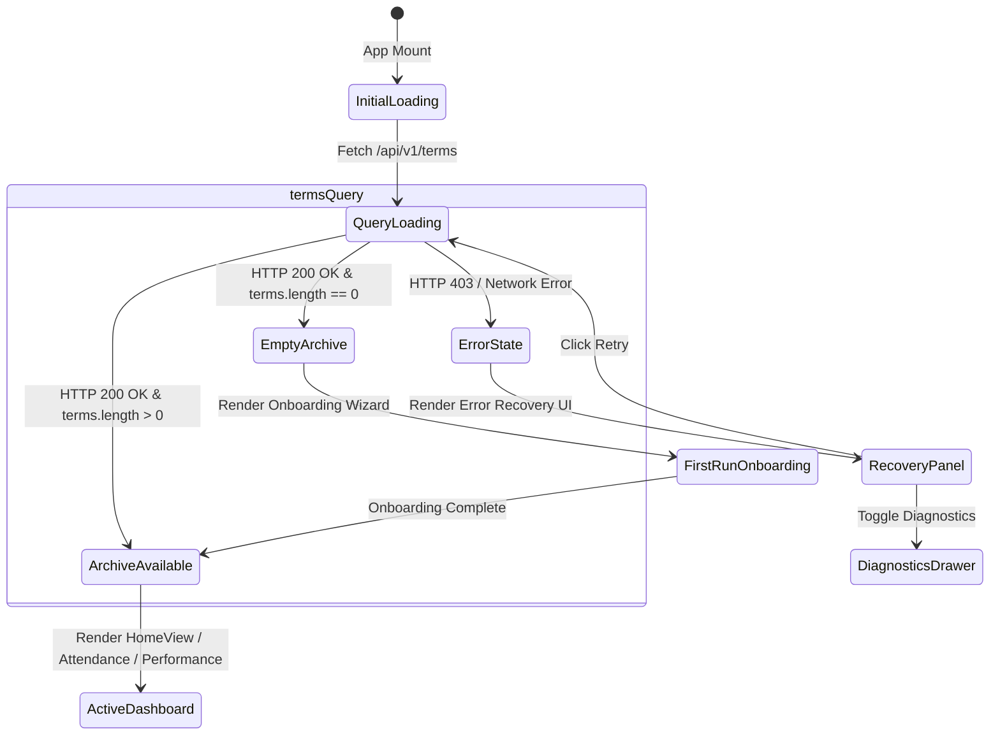

# ATTENDPLAN — PHASE G.4.3 LOCAL LAUNCHER & FIRST-RUN STATE RECOVERY REPORT

## 1. Incident Root Cause Analysis

### Background & Observed Symptoms
Following the Phase G.4.2R security hardening (which implemented strict loopback same-origin policy to prevent cross-site browser exploitation of local loopback endpoints), developers and testers executing the local development launcher (`Launch-AttendPlan.cmd` / `scripts/Launch-AttendPlan.ps1`) observed:
1. The dashboard unexpectedly displayed the **First-Run Onboarding Wizard ("Welcome to AttendPlan")**, despite the local database (`%LOCALAPPDATA%\AttendPlan\attendplan.sqlite3`) containing 5 academic semesters, 76 courses, and 3,544 attendance observations.
2. When the user entered their mobile number, the application failed to fetch data properly or appeared to loop.
3. If an instance of the frozen binary (`AttendPlan.exe`) had run previously on port 8000 in production mode, `Launch-AttendPlan.ps1` would see port 8000 responding and attempt to use it, but the running instance was bound in production mode rejecting development origins.

### Root Cause Breakdown
1. **Defect A: Development Origin Rejection (CORS / LocalOriginSecurityMiddleware)**
   - In G.4.2R, `LocalOriginSecurityMiddleware` was added to lock the backend to same-origin requests unless the environment variable `ATTENDPLAN_ENV` was set to `development`.
   - `Launch-AttendPlan.cmd` and `scripts/Launch-AttendPlan.ps1` did not set `ATTENDPLAN_ENV=development` in the spawned Python backend process environment.
   - `frontend/src/api/attendance.ts` had hardcoded `API_BASE = "http://127.0.0.1:8000"` when the window port was 5173, bypassing the Vite reverse proxy (`localhost:5173/api/...` -> `127.0.0.1:8000`) and triggering browser cross-origin requests directly to port 8000.
   - Consequently, all API requests (`/api/v1/terms`, etc.) from `http://127.0.0.1:5173` received HTTP 403 Forbidden.

2. **Defect B: State Collapsing in App.tsx**
   - In `frontend/src/App.tsx`, the terms query result was handled as:
     ```ts
     const terms = termsQuery.data ?? [];
     ```
   - When `termsQuery` failed with HTTP 403 Forbidden, `termsQuery.data` was `undefined`, defaulting `terms` to `[]`.
   - The conditional check `terms.length === 0 ? <FirstRunOnboarding /> : <HomeView />` evaluated to true.
   - An API authorization error was thus erroneously treated as a brand new, empty database.

3. **Defect C: FirstRunOnboarding Mobile Persistence Disconnect**
   - The developer's saved mobile number was already safely stored in `%LOCALAPPDATA%\AttendPlan\settings.json` under `saved_mobile_number`.
   - However, `FirstRunOnboarding.tsx` did not query the settings endpoint on mount to check if a saved mobile number already existed, requiring the user to re-enter it.
   - Furthermore, Step 4 allowed advancing to Step 5 (Historical Import) even when the portal was disconnected or in an error state.

---

## 2. Compatibility Matrix: Development vs. Production Mode

| Capability / Attribute | Production Mode (`ATTENDPLAN_ENV=""`) | Development Mode (`ATTENDPLAN_ENV="development"`) |
| :--- | :--- | :--- |
| **Bound Host** | `127.0.0.1` | `127.0.0.1` |
| **Bound Port** | Dynamic (default `8000`) | `8000` (fixed launcher port) |
| **Allowed Browser Origins** | Same-origin only (`http://127.0.0.1:8000`, `http://localhost:8000`) | Same-origin + Vite dev server (`http://127.0.0.1:5173`, `http://localhost:5173`) |
| **CORS Preflight Responses** | Rejects non-8000 origins with 403 Forbidden | Emits `Access-Control-Allow-Origin: <dev-origin>` |
| **Frontend API Routing** | Relative URL (`API_BASE = ""`) | Vite Proxy or Relative URL (`API_BASE = ""`) |
| **`/health` Reporting** | `mode: "production"` | `mode: "development"` |
| **`/api/v1/startup/shutdown`** | Requires `X-AttendPlan-Instance` header matching runtime token | Requires `X-AttendPlan-Instance` header matching runtime token |
| **Arbitrary Origin Protection** | Enforced (blocks external web origins & cross-site fetches) | Enforced (blocks external web origins & cross-site fetches) |

---

## 3. State Machine Recovery in Frontend

In `frontend/src/App.tsx`, four mutually exclusive states are now explicitly distinguished:



1. **`QUERY_LOADING` (`termsQuery.isLoading`)**:
   - Renders a clean loading spinner: *"Loading academic terms from local database..."*.
   - Never prematurely presents setup screens while waiting for SQLite disk read.
2. **`QUERY_ERROR` (`termsQuery.isError`)**:
   - Renders a recovery panel with clear diagnostic feedback: *"Could not load saved academic records"*.
   - Detects HTTP 403 Forbidden and provides actionable remediation text regarding environment mode.
   - Includes one-click **Retry**, **Diagnostics** drawer, and **Configure Authentication** buttons.
   - **Never falls through to First-Run Setup**.
3. **`GENUINELY_EMPTY_ARCHIVE` (`!isLoading && !isError && terms.length === 0`)**:
   - Only rendered when the local database is genuinely empty (zero academic terms).
4. **`EXISTING_ARCHIVE_FOUND` (`terms.length > 0`)**:
   - Renders the normal four-destination academic workspace (`home`, `attendance`, `performance`, `settings`).

---

## 4. Mobile Number Settings Provenance

### Local Storage Contract
- **File Location**: `%LOCALAPPDATA%\AttendPlan\settings.json`
- **Schema**:
  ```json
  {
    "saved_mobile_number": "9876543210",
    "auto_mobile_autofill": false,
    "auto_login_continuation": false,
    "auto_totp_autofill": false,
    "auto_totp_submit": false
  }
  ```
- **API Endpoint**: `GET /api/v1/auth/settings`
- **Public Response DTO** (`SettingsPublicResponse`):
  ```json
  {
    "has_saved_mobile": true,
    "masked_mobile": "******3210",
    "auto_mobile_autofill": false,
    "auto_login_continuation": false,
    "auto_totp_autofill": false,
    "auto_totp_submit": false
  }
  ```

### FirstRunOnboarding Integration
- When mounted, `FirstRunOnboarding` calls `fetchAuthSettings()`.
- If `has_saved_mobile` is true:
  - Step 2 displays a green card: *"Saved Mobile Number Detected: ******9050"*.
  - A primary button *"Continue with Saved Mobile"* advances directly to Step 3 without requiring the user to re-enter their phone number.
  - An option *"Change mobile number"* allows overriding if desired.
- In Step 4, advancing requires verifying that `portalStatus.state === "AUTHENTICATED"` to prevent false claims of authentication before attempting multi-semester synchronization.

---

## 5. Local Process Conflict & Port Handling

When a developer or user starts `scripts/Launch-AttendPlan.ps1`:
1. It queries `http://127.0.0.1:8000/health`.
2. If port 8000 responds, it inspects the reported `mode` and `runtime`:
   - If `mode == "production"` or `runtime == "frozen"`:
     - The script fetches `GET /api/v1/startup/status` to read `instance_token`.
     - It sends `POST /api/v1/startup/shutdown` with header `X-AttendPlan-Instance: <token>` to request graceful release of port 8000.
     - It waits up to 6 seconds for port 8000 to close cleanly.
3. The launcher configures `$env:ATTENDPLAN_ENV = "development"` and passes it explicitly in `System.Diagnostics.ProcessStartInfo.EnvironmentVariables` to the spawned Python process.
4. `Launch-AttendPlan.cmd` sets `set "ATTENDPLAN_ENV=development"` before invoking PowerShell.

---

## 6. Parity Audit Table: Database Integrity

A consistent WAL-safe backup was taken before code changes:
`%LOCALAPPDATA%\AttendPlan\backups\pre_g4_3_safety_backup.sqlite3` (2,019,328 bytes).

| Database Table / Metric | Pre-G.4.3 Count | Post-G.4.3 Count | Integrity / Parity Verdict |
| :--- | :--- | :--- | :--- |
| **`academic_terms`** | 5 | 5 | EXACT MATCH (100% Intact) |
| **`courses`** | 76 | 76 | EXACT MATCH (100% Intact) |
| **`attendance_period_observations`** | 3,544 | 3,544 | EXACT MATCH (100% Intact) |
| **`attendance_snapshots`** | 11 | 11 | EXACT MATCH (100% Intact) |
| **`attendance_snapshot_rows`** | 166 | 166 | EXACT MATCH (100% Intact) |
| **`performance_snapshots`** | 5 | 5 | EXACT MATCH (100% Intact) |
| **`sync_jobs`** | 110 | 110 | EXACT MATCH (100% Intact) |
| **`PRAGMA integrity_check`** | `ok` | `ok` | PASSED |

---

## 7. Verification Results

### 1. Backend Pytest Suite
- Command: `& "backend\.venv\Scripts\python.exe" -m pytest backend\tests -q`
- Result: **360 passed, 0 failed, 1 warning in 47.93s**

### 2. Backend Sanitization Suite
- Command: `& "backend\.venv\Scripts\python.exe" -m pytest backend\tests\test_sanitization.py -v`
- Result: **14 passed, 0 failed in 9.85s**

### 3. Backend Static Analysis & Typing
- Ruff: `ruff check backend\app backend\tests` -> **All checks passed!**
- Mypy: `mypy backend\app` -> **Success: no issues found in 46 source files**

### 4. Frontend Vitest Suite
- Command: `npm --prefix frontend test -- --run`
- Result: **14 test files passed, 43 tests passed in 64.23s**

### 5. Frontend Production Build
- Command: `npm --prefix frontend run build`
- Result: **tsc -b && vite build completed with exit code 0** (468.19 kB bundle)

### 6. End-to-End Development API Origin Check
- Backend launched with `ATTENDPLAN_ENV=development`
- `GET http://127.0.0.1:8000/health`: returned `mode: "development"`, `status: "healthy"`
- `GET http://127.0.0.1:8000/api/v1/terms` with `Origin: http://127.0.0.1:5173`: returned HTTP 200 OK with all 5 terms and `Access-Control-Allow-Origin: http://127.0.0.1:5173`
- Backend launched with `ATTENDPLAN_ENV` unset:
- `GET http://127.0.0.1:8000/api/v1/terms` with `Origin: http://127.0.0.1:5173`: returned HTTP 403 Forbidden (production security preserved)

---

## 8. Pull Request & Continuous Integration Status

- **Repository**: `https://github.com/XrystalAbyss/AttendPlan`
- **Feature Branch**: `feature/g4-real-beta-recovery`
- **Pull Request**: [#1](https://github.com/XrystalAbyss/AttendPlan/pull/1)
- **Verified Head Commit SHA**: `03c424ba7ada96a988ea2fb6916501587dd30466`
- **PR State**: `open` (Mergeable: `True`)
- **GitHub Actions Check Runs**:
  - `Backend Quality Gate`: **SUCCESS** (`conclusion=success`, pytest + ruff + mypy + sanitization)
  - `Frontend Quality Gate`: **SUCCESS** (`conclusion=success`, vitest + tsc + vite build)

