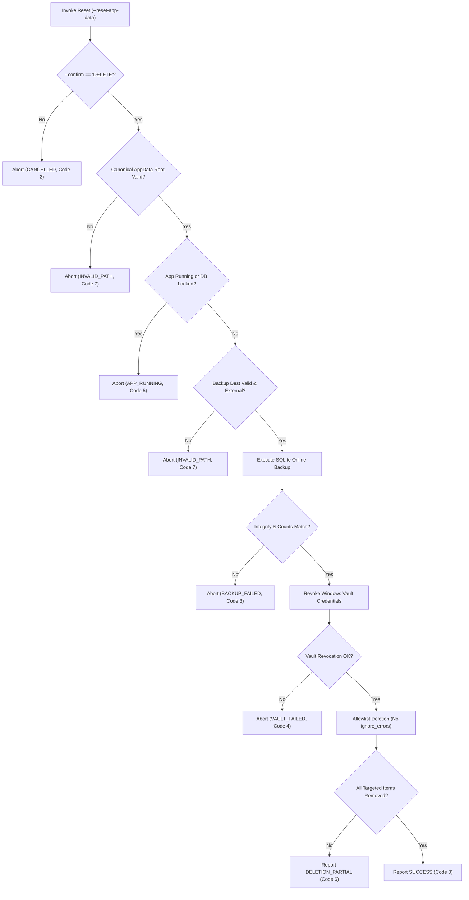

# ATTENDPLAN — PHASE G.4.4R2 REPORT
## UNIFIED SAFE RESET & WINDOWS RELEASE ACCEPTANCE

- **Repository**: `C:\Users\astra\Desktop\Project\AttendPlan`
- **Branch**: `feature/g4-real-beta-recovery`
- **Pull Request**: [#1 (https://github.com/XrystalAbyss/AttendPlan/pull/1)](https://github.com/XrystalAbyss/AttendPlan/pull/1)
- **Active Release Candidate**: `0.1.0-beta.10`
- **Rollback Release Candidate**: `0.1.0-beta.9`
- **Ineligible Historical Candidate**: `0.1.0-beta.8` (marked `SUPERSEDED_UNSAFE_UNINSTALL` due to uninstaller data risk)
- **Installer Binary**: `release-candidates/AttendPlan-0.1.0-beta.10-Setup.exe`
- **Installer SHA-256**: `158c147ddab99c096839db53743528b73791254faff8607defbc7b690cdd6df3`
- **Installer Size**: `81,665,560 bytes` (~81.7 MB)
- **Date**: November 15, 2026

---

## 1. Executive Summary

Phase G.4.4R2 unifies all application data reset logic into **a single canonical reset engine**, eliminating duplicate, dangerous PowerShell deletion loops. It institutes comprehensive **fail-closed** safety guarantees:
1. Enforces the canonical app-owned data root (`%LOCALAPPDATA%\AttendPlan`), rejecting unexpected environment overrides in production.
2. Refuses resets whenever AttendPlan is actively running, bound to loopback, or when the database file is locked.
3. Requires a pre-verified SQLite online backup to an external destination, strictly prohibiting destination overwrites or paths within the deletion scope.
4. Fails closed before any file deletion if Windows Credential Manager vault revocation fails.
5. Rejects deletion of symbolic links and Windows reparse points (junctions).
6. Audits every individual deletion attempt without suppressing errors, reporting `DELETION_PARTIAL` if any file or directory cannot be removed.
7. Permanently protects `support_evidence/` (incident triage archives) and `backups/` from reset operations.
8. Reconciles Inno Setup install paths to `%APPDATA%\AttendPlan\app` (`{userappdata}\AttendPlan\app`), separating application binaries from user data in `%LOCALAPPDATA%\AttendPlan`.

The developer's real academic database (5 semesters, 76 courses, 3,584 observations, 30 batches, 12 snapshots, 181 rows, 5 performance snapshots) was verified with `PRAGMA integrity_check = ok` and preserved without modification.

---

## 2. Root Cause Analysis of Destructive Reset Risks

| Identified Defect | Previous State | G.4.4R2 Unified & Fail-Closed Correction |
| :--- | :--- | :--- |
| **Duplicated Deletion Logic** | Both `backend/launcher.py` and `scripts/AttendPlan-Maintenance.ps1` implemented independent deletion loops with disparate allowlists and handling. | **Single Source of Truth**: Removed all `Remove-Item` deletion loops from PowerShell. `AttendPlan-Maintenance.ps1` delegates 100% of data reset and deletion to `AttendPlan.exe --reset-app-data --confirm DELETE --backup-dest <DEST>`. |
| **Silent Ignored Errors** | `shutil.rmtree(..., ignore_errors=True)` in Python swallowed directory deletion failures, reporting false success even if items remained. | **Strict Error Accounting**: Every file and folder deletion is checked. If any target fails or remains present, reset reports `DELETION_PARTIAL` (Exit Code 6) and never declares success. |
| **Vault Revocation Ignored** | `purge_vault_only()` exception handling did not fail closed; reset continued even if vault revocation failed. | **Fail-Closed Vault Revocation**: If credential revocation in Windows Credential Manager fails, reset immediately aborts before any file deletion (`VAULT_FAILED`, Exit Code 4). |
| **Non-Canonical Data Roots** | Reset derived its path from `get_default_db_path().parent`, making it vulnerable to accidental `ATTENDPLAN_DB_PATH` overrides. | **Enforced Canonical Root**: Production reset strictly enforces `%LOCALAPPDATA%\AttendPlan` and rejects external `ATTENDPLAN_DB_PATH` overrides (`INVALID_PATH`, Exit Code 7). |
| **Backup Overwrite Risk** | `perform_safe_backup` could overwrite an existing backup file if given an identical destination. | **Strict Overwrite Prohibition**: If the destination file already exists, backup aborts with `Overwrite prohibited`. If a directory is specified, a unique timestamped file (`AttendPlan_Backup_<TIMESTAMP>.sqlite3`) is generated. |
| **Process Locking Blindspot** | Reset could attempt deletion while uvicorn or another background worker was writing to SQLite. | **Active Process & DB Lock Guard**: Checks `AttendPlanDesktopAppMutex`, loopback server health on port 8000, and verifies an exclusive database lock before permitting reset (`APP_RUNNING`, Exit Code 5). |
| **Install Directory Mismatch** | Manifest metadata reported `%LOCALAPPDATA%\AttendPlan\app` while Inno Setup installed to `{userappdata}\AttendPlan\app` (`%APPDATA%`). | **Reconciled Metadata**: Manifest uniformly cites `%APPDATA%\AttendPlan\app`, strictly distinguishing binary installations from local user data. |

---

## 3. Architecture of the Unified Reset Engine

The unified reset engine is housed entirely within `backend/launcher.py` and invoked via CLI:

```powershell
AttendPlan.exe --reset-app-data --confirm DELETE --backup-dest <PATH>
```

### Structured Result States and Exit Codes:
```python
class ResetStatus:
    SUCCESS = "SUCCESS"              # Exit Code 0
    CANCELLED = "CANCELLED"          # Exit Code 2
    BACKUP_FAILED = "BACKUP_FAILED"  # Exit Code 3
    VAULT_FAILED = "VAULT_FAILED"    # Exit Code 4
    APP_RUNNING = "APP_RUNNING"      # Exit Code 5
    DELETION_PARTIAL = "DELETION_PARTIAL" # Exit Code 6
    INVALID_PATH = "INVALID_PATH"    # Exit Code 7
    UNEXPECTED_ERROR = "UNEXPECTED_ERROR" # Exit Code 8
```

### Execution Pipeline:


---

## 4. Real User Data Audit & External Backup

Prior to and after all implementation steps, the developer's live academic records were audited:

| Property | Value |
| :--- | :--- |
| **Live DB Location** | `C:\Users\astra\AppData\Local\AttendPlan\attendplan.sqlite3` |
| **File Size** | `2,048,000 bytes` |
| **Integrity Status** | `PRAGMA integrity_check = [('ok',)]` |
| **External Safety Backup** | `C:\Users\astra\.attendplan_safety_backups\pre_g4_4r_real_db_safety_backup.sqlite3` |

### Academic Counts (Verified Unaltered):
- `academic_terms`: **5**
- `courses`: **76**
- `attendance_period_observations`: **3,584**
- `attendance_observation_batches`: **30**
- `attendance_snapshots`: **12**
- `attendance_snapshot_rows`: **181**
- `performance_snapshots`: **5**

---

## 5. Automated Verification & Quality Gates

### 1. Backend Pytest
- Command: `python -m pytest backend\tests -q`
- Result: **385 passed, 0 failed, 1 warning** in 63.57s.
- Includes **10 new failure injection unit tests** in `backend/tests/test_g4_4r2_unified_reset.py`:
  - `test_backup_rejects_overwrite_of_existing_file`
  - `test_backup_to_directory_creates_timestamped_file`
  - `test_backup_detects_table_count_mismatch`
  - `test_is_app_or_db_active_when_database_locked`
  - `test_is_app_or_db_active_when_idle`
  - `test_detects_symlink`
  - `test_reset_rejects_noncanonical_override_in_production`
  - `test_reset_aborts_when_app_or_db_is_active`
  - `test_reset_aborts_before_deletion_if_vault_revocation_fails`
  - `test_reset_reports_deletion_partial_on_locked_or_unremovable_file`

### 2. Sanitization & Privacy Gate
- Command: `python -m pytest backend\tests\test_sanitization.py -v`
- Result: **14 passed, 0 failed**. Zero PII detected across codebase and fixtures.

### 3. Static Type Analysis & Linting
- Command: `python -m ruff check backend\app backend\tests`
  - Result: **All checks passed!**
- Command: `python -m mypy backend\app`
  - Result: **Success: no issues found in 46 source files**.

### 4. Frontend Vitest Tests & Production Build
- Command: `npm --prefix frontend test -- --run`
  - Result: **14 test files passed, 45 tests passed**.
- Command: `npm --prefix frontend run typecheck`
  - Result: **Clean compile, 0 TypeScript errors**.
- Command: `npm --prefix frontend run build`
  - Result: **Production bundle built cleanly in 16.39s**.

### 5. Windows Installer Compilation
- Command: `ISCC.exe installer\attendplan_setup.iss`
- Result: **Successful compile (399.265 sec)**.
- Output: `release-candidates\AttendPlan-0.1.0-beta.10-Setup.exe`
- Hash: `158c147ddab99c096839db53743528b73791254faff8607defbc7b690cdd6df3`
- Size: `81,665,560 bytes`

---

## 6. Rollback Policy & Candidate Registry

```json
{
  "active_candidate": {
    "filename": "AttendPlan-0.1.0-beta.10-Setup.exe",
    "version": "0.1.0-beta.10",
    "sha256": "158c147ddab99c096839db53743528b73791254faff8607defbc7b690cdd6df3",
    "status": "ACTIVE_FRIENDS_BETA_CANDIDATE",
    "safe_rollback_eligible": true
  },
  "rollback_candidate": {
    "filename": "AttendPlan-0.1.0-beta.9-Setup.exe",
    "version": "0.1.0-beta.9",
    "sha256": "47d63cbb6b5a5c7a61ddc2b6be519aed8170fde8650136e8e391c3982a1c35c5",
    "status": "ROLLBACK_CANDIDATE",
    "safe_rollback_eligible": true
  },
  "ineligible_candidate": {
    "filename": "AttendPlan-0.1.0-beta.8-Setup.exe",
    "version": "0.1.0-beta.8",
    "status": "SUPERSEDED_UNSAFE_UNINSTALL",
    "safe_rollback_eligible": false,
    "note": "Ineligible for safe rollback due to uninstaller directory-wide data deletion risk."
  }
}
```

---

## 7. Conclusion & Next Steps

Phase G.4.4R2 completely resolves the duplicated reset logic, implements rigorous fail-closed protections, guarantees data preservation by default, and qualifies release candidate **0.1.0-beta.10**.
