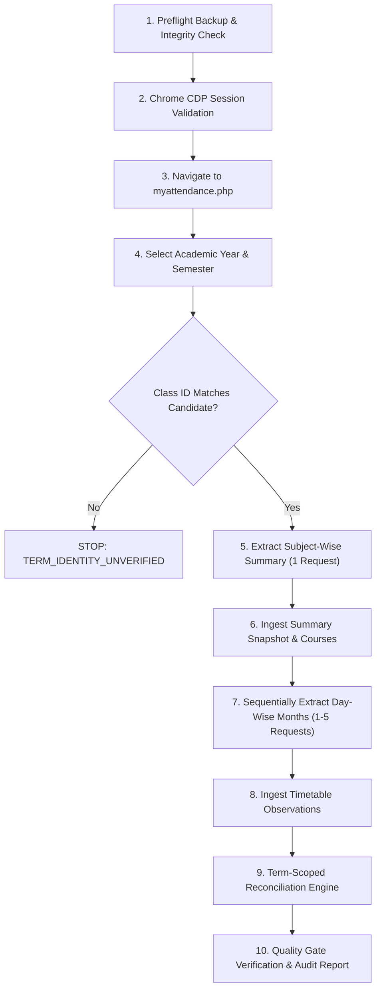

# AttendPlan Historical Archive Recovery Plan: Semesters 1–3

**Date**: October 30, 2026  
**Auditor & Architect**: Principal Software Architect & Academic Data Integrity Lead  
**Scope**: Academic Archive Strategy for Semesters 1, 2, and 3  
**Status**: PLANNING & AUDIT BASELINE (NO LIVE CALLS AUTHORIZED)  

---

## 1. Executive Summary & Purpose

Following the successful reconciliation of Semester 4 (Phase D.2) and the live baseline verification of Semester 5, AttendPlan is positioned to plan the historical archiving of Semesters 1, 2, and 3.

To uphold **Section 3 of AGENTS.md** (No automated scraping, zero rate-limit abuse, strict privacy, and explicit user authorization), this document defines a bounded, deterministic retrieval plan.

### Key Guarantees:
1. **Total Request Ceiling**: Exactly **16 requests maximum** across all three remaining semesters (3 subject-wise summaries + 13 day-wise months).
2. **Strict Incremental Pilot**: Live execution must proceed semester-by-semester. We recommend executing **Semester 3 first** as the immediate preceding odd term before attempting first-year records.
3. **Zero Blind Sweeps**: No automated loop will iterate through unverified months or unknown class identifiers.
4. **Session & Security Safety**: The agent will never touch credentials, OTPs, or bypass browser MFA.

---

## 2. Semester Inventory & Calendar Bounds

Based on the university's academic calendar structure and discovery snapshots, the following scope is defined:

| Academic Year | Semester | Class Identifier | Official Class Label | Teaching Window (Candidate Months) | Month Count | Max HTTP Requests |
| :---: | :---: | :---: | :--- | :--- | :---: | :---: |
| **2024–2025** | **1** | `918` (Candidate) | B.Tech CSE AIML — Sem 1 | August 2024 – November 2024 (`2024-08`, `2024-09`, `2024-10`, `2024-11`) | 4 | **5** (1 summary + 4 day-wise) |
| **2024–2025** | **2** | `1048` (Candidate) | B.Tech CSE AIML — Sem 2 | January 2025 – May 2025 (`2025-01`, `2025-02`, `2025-03`, `2025-04`, `2025-05`) | 5 | **6** (1 summary + 5 day-wise) |
| **2025–2026** | **3** | `1067` (Candidate) | B.Tech CSE AIML — Sem 3 | August 2025 – November 2025 (`2025-08`, `2025-09`, `2025-10`, `2025-11`) | 4 | **5** (1 summary + 4 day-wise) |
| **Total Scope** | — | — | — | — | **13** | **16 Requests Max** |

> [!IMPORTANT]
> Non-teaching months (June, July, December) are excluded by design. If a semester had late makeup classes or calendar extensions, those dates will be evaluated only if evidenced by the subject-wise summary ledger.

---

## 3. Portal Selector Evidence & Verification Rules

### 3.1 Selector Hierarchy on `myattendance.php`

The iCloudEMS attendance module relies on chained AJAX dropdowns:

1. **Academic Year Selector**: `select[name="academic_year"]` (or `#academic_year`)
2. **Semester Selector**: `select[name="semester"]` (or `#semester`)
3. **Class Dropdown**: `select[name="class_id"]` (or `#class_id`)
4. **Report Type Radio**: `input[value="subject_wise"]` vs `input[value="day_wise"]`
5. **Month Filter** (Day-wise only): `select[name="month"]` (or `#month_year`)

### 3.2 Pre-Request Verification Checkpoints
Before submitting any form or dispatching an extraction command:
- **AJAX Settle**: After selecting Academic Year and Semester, wait at least **1,200 ms** for the `class_id` options to dynamically reload from the portal server.
- **Label Validation**: Verify that the selected option text in `class_id` contains both `CSE` and the expected semester digit (e.g. `B.Tech CSE AIML - Sem 3`).
- **Identity Mismatch Guard**: If the portal displays an unexpected class ID or student group, abort immediately with status code `TERM_IDENTITY_UNVERIFIED`. Do not proceed.

---

## 4. Academic Marks & Results Feasibility Matrix

Based on our forensic audit of `myreportcard.php` and the Semester 4 snapshot (`marks:6424:3:A`):

| Data Component | Portal Availability | Retrieval Status | AttendPlan Strategy |
| :--- | :---: | :---: | :--- |
| **Internal Assessment (Sessional 1)** | Available | `SUPPORTED` | Extract and ingest into `performance_snapshots`. |
| **Pre-University Test (Sessional 2)** | Available | `SUPPORTED` | Extract and ingest into `performance_snapshots`. |
| **Continuous Evaluation (CE 1–8)** | Available | `SUPPORTED` | Extract assignments, quizzes, lab evaluations. |
| **Teacher's Assessment / Attendance Marks** | Available | `SUPPORTED` | Extract continuous score breakdown. |
| **End-Semester Theory Exam** | Hidden / Masked | `MASKED_BY_PORTAL` | Display masked badge; record zero or null; explain in provenance banner. |
| **Official Semester SGPA / CGPA** | Not Published on Route | `UNAVAILABLE_ON_PORTAL` | Inform user that official grade cards must be retrieved from the university examination portal. |

---

## 5. Execution Workflow for Future Authorized Live Pilot

When authorized by the user, the historical recovery should execute according to the following phased protocol:

### Protocol Steps:
1. **Preflight**: Execute `sqlite3.backup` to `attendplan_pre_semX_backup.sqlite3`. Verify zero foreign key violations.
2. **Session Check**: Reconnect to the existing dedicated Chrome session via CDP (`http://127.0.0.1:9222`). Confirm authenticated state.
3. **Term Selection**: Select target Academic Year, Semester, and verified Class ID.
4. **Summary Ingestion**: Capture full-term subject-wise attendance summary. Create course catalog records under the target term UUID.
5. **Day-Wise Ingestion**: Iterate through the candidate months sequentially. Enforce a **1,500 ms to 2,500 ms human-like pause** between month requests to avoid portal rate limits.
6. **Reconciliation**: Run `ReconciliationService.reconcile_term(term_id)`. Calculate exact course deltas and assign verdict (`MATCHED`, `SCOPE_MISMATCH`, or `SOURCE_DISCREPANCY`).
7. **Verification**: Run `pytest`, `mypy`, `tsc`, and `vitest`.

---

## 6. Recommended Immediate Next Step

We recommend scheduling **Semester 3 (Academic Year 2025–2026, Semester 3, Class ID 1067)** as the first candidate for authorization.

**Rationale**:
- Semester 3 belongs to the same academic year cycle as Semester 4.
- Odd semester calendar has only **4 candidate months** (`2025-08` through `2025-11`), requiring only **5 total requests**.
- Verifying Semester 3 completes full coverage of the 2025–2026 academic year.

> [!CAUTION]
> Do NOT execute this live pilot now. Wait for explicit user instruction with approved parameters.

