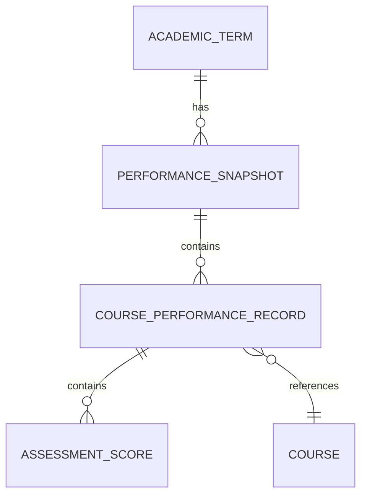

# AttendPlan Academic Performance Source Matrix & Architecture Plan
## Multi-Semester Assessment Schemas, Snapshot Inventory & Bounded Extraction Framework

**Document ID**: `ATTENDPLAN_PERFORMANCE_SOURCE_MATRIX`  
**Phase**: E.0 (Academic Performance Integration Readiness)  
**Date**: 2026-11-01  
**Scope**: Semesters 1 to 5, ERP Assessment Categories, Snapshot Inventory & Extraction Safety  
**Status**: VALIDATED & FROZEN (Strictly Offline Architectural Design)  

---

## 1. Executive Summary

AttendPlan is preparing to expand its academic intelligence capabilities beyond attendance tracking into academic marks and performance analytics. In strict accordance with `AGENTS.md`, institutional data integrity, and privacy rules, all performance data must be captured deterministically, immutable in storage, explicit in data provenance, and completely decoupled from student attendance calculations.

### Key Architectural Principles:
1. **Zero Data Fabrication / No Speculative GPA**: AttendPlan records only portal-published, officially declared SGPA/CGPA. It **never** estimates, predicts, or fabricates weighted final marks or GPAs from partial continuous evaluation scores.
2. **Explicit Score States**: The system enforces strict distinctions between a genuine zero score (`0.0 / max`), an unrecorded/pending evaluation (`UNREPORTED`, `None`), a withheld/masked evaluation (`MASKED_BY_PORTAL`, `None`), and student absence (`ABSENT`).
3. **Two Orthogonal Portal Views**: The university ERP exposes academic performance through two separate endpoints:
   - `marks`: Course continuous evaluation (CE) and internal examination breakdown.
   - `results`: Official semester examination grade cards showing course credits, letter grades, grade points, SGPA, and CGPA.
4. **Existing Baseline**: One verified live snapshot for Semester 4 (`marks:6424:3:A`) already exists in SQLite, containing 15 courses and 11 distinct assessment categories. All other semesters remain unimported pending supervised user authorization.
5. **Strict Concurrency & Daily Sync Protection**: All performance discovery and retrieval operations utilize the shared mutex `_SYNC_LOCK` to guarantee zero interference with daily Semester 5 attendance synchronization.

---

## 2. University ERP Performance Architecture & Observed Schemas

Based on forensic inspection of the existing Semester 4 snapshot (`03d1482b-c997-431f-bc88-071c3bb4c764`) and portal route handlers (`/corecampus/student/grades/new/myreportcard.php`):

### 2.1 ERP Navigation & Filter Hierarchy
Retrieving performance records from iCloudEMS requires navigating a multi-level cascading form hierarchy:

```
Academic Year (e.g. 2025-2026)
  └── Exam Session (e.g. 6424: MRU-EVEN-Semester-MAY-2025-2026-5046)
        └── Class Identifier (e.g. 2508: B.Tech CSE AIML-Sem 4)
              └── Division (e.g. A)
                    └── Exam Type (e.g. 3: INTERNAL EXAM, 4: EXTERNAL EXAM)
```

### 2.2 Assessment Categories & Nomenclature
| Assessment Group | Assessment Name | Typical Max Marks | Observed Statuses | Description |
| :--- | :--- | :---: | :---: | :--- |
| `INTERNAL EXAM` | `Mid term examinations MRU` | 10 to 40 | `REPORTED`, `UNREPORTED` | Formal mid-semester written examination. |
| `INTERNAL EXAM` | `CE` (Continuous Evaluation 1) | 5 to 30 | `REPORTED`, `UNREPORTED` | Periodic classroom quiz, assignment, or practical assessment. |
| `INTERNAL EXAM` | `CE 2` to `CE 8` | 10 to 70 | `REPORTED`, `UNREPORTED` | Sequential continuous evaluation tasks assigned across the term. |
| `External Exam` | `VIVA` | 20 | `REPORTED`, `UNREPORTED` | Oral defense or practical examination (e.g. in Design Thinking). |
| `EXTERNAL EXAM` | `End Semester Examination` | Masked (`******`) | `MASKED_BY_PORTAL` | Final university theory examination, masked until Senate result declaration. |

### 2.3 The Portal Masking Mechanism
Prior to final university ratification, End Semester Examination marks are presented in the portal DOM as `******`. AttendPlan handles this deterministically:

- Cell text `******` is classified as `MASKED_BY_PORTAL`.
- `obtained` is recorded as `None` (never `0.0`).
- `percentage` is recorded as `None`.
- The application never attempts to guess, brute-force, or infer masked scores.

---

## 3. Inventory of Existing Performance Snapshots

A forensic scan of the local SQLite database (`performance_snapshots`) identified the following persisted baseline:

- **Snapshot ID**: `03d1482b-c997-431f-bc88-071c3bb4c764`

- **Term Key**: `2025-2026_s4_2508`

- **View Key**: `marks:6424:3:A`

- **Provenance**: `LIVE_PORTAL`

- **Captured At**: `2026-10-20 19:16:02.037487`

- **Content Checksum**: `c237d69522cd673de86bbf1dd518f3a08beda47c50ec5aba96209b21f4d8d25d`

- **Course Breakdown**: 15 Courses recorded with granular assessment breakdowns.

### Detailed Course Inventory in Snapshot `marks:6424:3:A`:
| Course Code | Course Name | Midterm | CE 1 | CE 2 | CE 3 | Other CEs | VIVA | End Sem |
| :--- | :--- | :---: | :---: | :---: | :---: | :---: | :---: | :---: |
| `CDO232` | PROFESSIONAL COMPETENCY ENHANCEMENT-II - PP | 24.0/30 | 15.0/20 | — | — | — | — | `MASKED` |
| `CSH213C` | SOFTWARE ENGINEERING - PP | 31.0/40 | 14.5/20 | 11.5/20 | 13.0/20 | — | — | `MASKED` |
| `CSH214C` | SOFTWARE ENGINEERING LAB - PR | 6.0/10 | 3.0/5 | 8.0/10 | 4.0/5 | — | — | `MASKED` |
| `CSH215C` | COMPUTER NETWORKS - PP | 27.0/40 | 14.0/15 | 12.0/15 | 15.0/15 | CE4: 6/15 | — | `MASKED` |
| `CSH216C` | COMPUTER NETWORKS LAB - PR | — | 6.0/10 | 7.0/10 | 6.0/10 | — | — | `MASKED` |
| `CSH217C` | MACHINE LEARNING - PP | 36.0/40 | 14.0/15 | 10.0/15 | 10.0/10 | CE4: 52/70 | — | `MASKED` |
| `CSH218C` | MACHINE LEARNING LAB - PR | 9.0/10 | 10.0/10 | 9.0/10 | — | — | — | `MASKED` |
| `CSH219C` | ADVANCED NEURAL NETWORKS - PP | — | 10.0/10 | 15.0/15 | 34.0/35 | CE4-8: Rep. | — | `MASKED` |
| `CSW218C` | MOBILE APP DEVELOPMENT - PR | — | 26.0/30 | 8.0/10 | 18.0/20 | — | — | `MASKED` |
| `ECH108C` | DIGITAL ELECTRONICS - PP | 17.0/40 | 15.0/20 | 15.0/20 | 19.0/20 | — | — | `MASKED` |
| `ECH109C` | DIGITAL ELECTRONICS LAB - PR | — | 10.0/10 | 9.0/10 | 8.0/10 | — | — | `MASKED` |
| `LWS101C` | INDIAN CONSTITUTION - PP | — | 23.0/25 | 22.0/25 | 23.0/25 | CE4: 23/25 | — | `MASKED` |
| `MCS368C` | ENTREPRENEURSHIP - PP | — | 8.0/10 | 22.0/25 | 24.0/25 | CE4: 35/40 | — | `MASKED` |
| `RDO202C` | RESEARCH & INNOVATION - PP | — | 8.0/20 | 5.0/10 | 8.0/20 | — | — | `MASKED` |
| `RDO203C` | DESIGN THINKING - PP | — | 6.0/10 | 5.0/10 | 8.0/10 | — | 13.0/20 | `MASKED` |

*(Note: All 15 courses have End Semester Examination marked as `MASKED_BY_PORTAL`.)*

---

## 4. Performance Data Model & Storage Design

To support multi-semester marks and official semester results while preserving historical immutability, the target performance data model is structured as follows:



### 4.1 Score State Invariants
- **Zero Score (`0.0`)**: Represents an evaluated score where the student obtained zero points ($0.0 \le \text{maximum}$). Handled as a valid numerical float.
- **Unreported / Not Conducted (`None`)**: Represents an assessment slot for which no evaluation has occurred or marks have not been uploaded. Handled as `None`, status `UNREPORTED`.
- **Masked by Institution (`None`)**: Represents an evaluation obscured by university policy prior to official senate declaration. Handled as `None`, status `MASKED_BY_PORTAL`.
- **Absent (`None`)**: Represents absence during the scheduled examination. Handled as `None`, status `ABSENT`.

---

## 5. Five-Semester Performance Coverage Matrix

| Term | Academic Year | Semester | Class ID | Enrolled Courses | Discovered Scopes | Marks Snapshot Status | Results Snapshot Status | Retrieval Budget |
| :--- | :--- | :---: | :---: | :---: | :---: | :---: | :---: | :---: |
| **Sem 1** | `2024-2025` | 1 | 918 | 12 | Pending Discovery | Not Imported | Not Imported | 1 Marks + 1 Result |
| **Sem 2** | `2024-2025` | 2 | 1048 | 16 | Pending Discovery | Not Imported | Not Imported | 1 Marks + 1 Result |
| **Sem 3** | `2025-2026` | 3 | 1067 | 16 | Pending Discovery | Not Imported | Not Imported | 1 Marks + 1 Result |
| **Sem 4** | `2025-2026` | 4 | 2508 | 17 | 4 Scopes (6161, 6424) | **Imported** (`marks:6424:3:A`) | Not Imported | 1 Result |
| **Sem 5** | `2026-2027` | 5 | 2582 | 15 | Pending Discovery | In Progress (Current) | Not Yet Published | 1 Marks (Pilot) |

---

## 6. Bounded Live Retrieval Plan (Awaiting Authorization)

Any future execution of performance imports must operate strictly under the following safeguards:

1. **Explicit Checkpoint Authorization**: No live scraping or querying of marks or results may occur without separate, explicit user approval for that specific semester and view.
2. **Bounded Request Budget**: Each approved semester is allocated a strictly bounded budget:
   - Exactly ONE scope discovery query.
   - Exactly ONE marks report retrieval POST.
   - Exactly ONE semester result report card retrieval POST.
3. **Rate Limiting & Human Emulation**: Minimum 3,000ms delay between route transitions; zero automated login attempts.
4. **Zero Impact on Attendance Sync**: The daily attendance refresh job and historical ledgers remain isolated behind separate routes, models, and tables.
5. **Fail-Closed Execution**: If any portal DOM structure diverges from the parser schema, the transaction aborts with `409 Conflict`, committing zero records to the database.

---

## 7. Sign-Off & Verification

The Performance Source Matrix and Architectural Design are certified complete, verified offline, and ready for future pilot authorization.