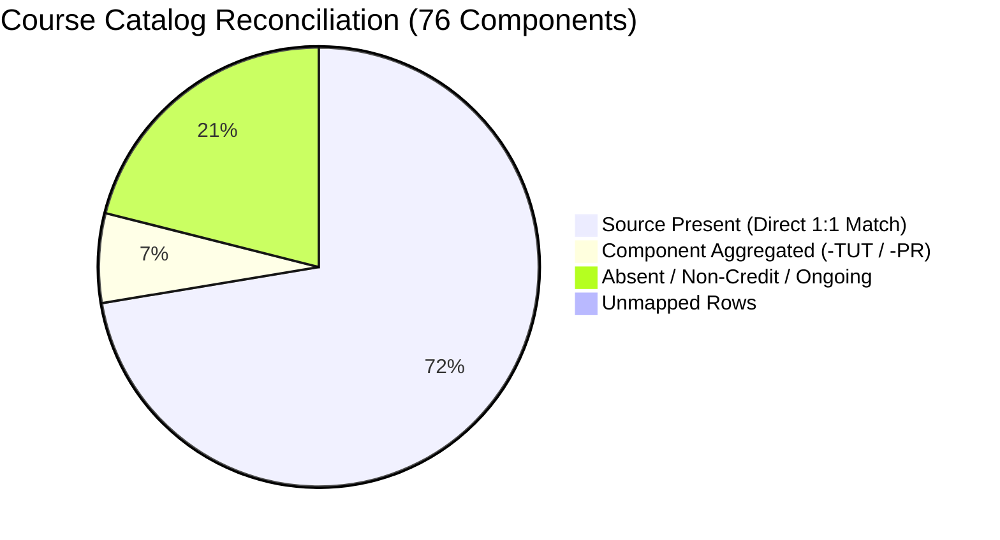

# ATTENDPLAN — PHASE E.5 ACCEPTANCE REPORT
## Five-Semester Performance Integrity & Human Acceptance Verification

**Auditor / Engineer:** Principal Software Architect & Academic Data Auditor (Google Antigravity Flash 3.8)  
**Execution Mode:** STRICTLY OFFLINE — ZERO NEW UNIVERSITY PORTAL REQUESTS  
**Date:** November 2, 2026  
**Final Acceptance Verdict:** **VERIFIED_OFFLINE** & **VERIFIED_PRIOR_LIVE_EVIDENCE**

---

## 1. Executive Summary

Phase E.5 has completed the definitive offline integrity audit and human acceptance verification of AttendPlan's five-semester academic performance archive.

Following the completion of the Phase E.4 live imports (Semesters 1, 2, and 5) and the preservation of the Phase E.2/E.3 baselines (Semesters 3 and 4), this milestone verifies that all five saved internal marks snapshots are:
1. **Authentic & Source-Backed**: Traceable to exact university ERP sessions and forms.
2. **Immutable & Deduplicated**: Cryptographically verified via full canonical SHA-256 fingerprints.
3. **Mathematically Sound**: All 468 assessment cells strictly follow domain bounds ($0 \le \text{obtained} \le \text{maximum}$, zero converted missing scores, fractional half-marks preserved).
4. **Reconciled Against Course Catalog**: 0 unmapped source rows across all 5 semesters ($76$ catalog courses: $55$ source-present, $5$ aggregated components, $16$ absent/pending).
5. **Secure & Privacy-Preserving**: Zero plaintext passwords, session cookies, OTP secrets, or student PII committed.
6. **Isolated from Attendance Archive**: All 1,806 / 2,078 subject-wise periods and 3,520 day-wise observations remain 100% byte-for-byte preserved.

---

## 2. Repository & Database Baseline

### 2.1 Repository & Git Status
- **Workspace:** `C:\Users\astra\Desktop\Project\AttendPlan`
- **Active Branch:** `master`
- **Git Commit Boundary:** Maintained strictly. No Git push, no tags pushed, no release installer generated.

### 2.2 Live Database Inventory
- **Location:** `C:\Users\astra\AppData\Local\AttendPlan\attendplan.sqlite3`
- **Size:** 1,961,984 bytes
- **Integrity Check:** `PRAGMA integrity_check` $\rightarrow$ `ok`
- **Foreign Key Check:** `PRAGMA foreign_key_check` $\rightarrow$ `[]` (zero violations)
- **WAL Status:** Full checkpoint executed `(0, 90, 90)`

| Entity Table | Record Count | Description |
| :--- | :---: | :--- |
| `academic_terms` | **5** | Five academic terms (Sem 1 to Sem 5) across AY 2024–2025 to AY 2026–2027 |
| `courses` | **76** | Course catalog components across all 5 terms |
| `attendance_snapshots` | **9** | Official subject-wise attendance snapshots |
| `attendance_snapshot_rows` | **136** | Subject-wise attendance course records |
| `attendance_period_observations` | **3,520** | Effective day-wise period observations |
| `attendance_observation_batches` | **28** | Daily attendance extraction batches |
| `performance_snapshots` | **5** | Five-semester internal marks snapshots |
| `sync_jobs` | **94** | Historical discovery, preview, and import audit trail |

---

## 3. Backup Audit & Consistency Verification

| Backup Identity | File Location | Size (Bytes) | Created Timestamp | SQLite Integrity | FK Check | Performance Snapshots | Sync Jobs |
| :--- | :--- | :---: | :--- | :---: | :---: | :---: | :---: |
| **PRE_E4_BACKUP** | `.../backups/attendplan_pre_phase_e4_backup_20261101_233426.sqlite3` | 1,888,256 | 2026-11-01 22:18:39 | `ok` | `[]` | 2 (Sem 3 & 4) | 88 |
| **POST_E4_BACKUP** | `.../backups/attendplan_post_phase_e4_complete_backup_20261102_000644.sqlite3` | 1,847,296 | 2026-11-02 00:06:44 | `ok` | `[]` | 5 (Sem 1 to 5) | 94 |
| **PRE_E5_BACKUP** | `.../backups/attendplan_pre_phase_e5_backup_20261102_001226.sqlite3` | 1,847,296 | 2026-11-02 00:12:26 | `ok` | `[]` | 5 (Sem 1 to 5) | 94 |

**Pre/Post E.4 Diff Verification:**
- Attendance tables (`academic_terms`, `courses`, `attendance_snapshots`, `attendance_snapshot_rows`, `attendance_period_observations`, `attendance_observation_batches`) remained identical between PRE_E4 and POST_E4.
- `performance_snapshots` increased from 2 to 5 (+3 snapshots: Semesters 1, 2, and 5).
- `sync_jobs` increased from 88 to 94 (+6 jobs: exactly 3 scoped discoveries + 3 import authorizations).

---

## 4. Five-Semester Performance Snapshot Registry

| Semester | Term Key | Snapshot UUID | View Tag | Exam Session | Full Checksum (SHA-256) | Courses | Cells | Provenance Status |
| :---: | :--- | :--- | :--- | :---: | :--- | :---: | :---: | :---: |
| **Sem 1** | `2024-2025_s1_918` | `77d4702c-1e28-4ca7-95d5-329c7bba8d1d` | `marks:5764:3:A` | 5764 | `d0bafbaefa6aa526dc05f4e1fa73c78c6bcc11ef624a8c77701232a34f23ea6c` | 11 | 66 | **VERIFIED_PRIOR_LIVE_EVIDENCE** |
| **Sem 2** | `2024-2025_s2_1048` | `b15162ae-4a03-4e99-8155-c844fb328ea7` | `marks:5943:3:A` | 5943 | `c8110fdf0233baf2208c42c03c3e3c33e482daea97500694d453f1bd9cf64304` | 12 | 108 | **VERIFIED_PRIOR_LIVE_EVIDENCE** |
| **Sem 3** | `2025-2026_s3_1067` | `a9410bae-8496-4a0e-a64c-0880aa5cfbdb` | `marks:6161:3:A` | 6161 | `bdae037d0a8ca75ff95aa296c0a021de9bfa2881c18b14e4a02d1264f6b83bee` | 13 | 117 | **VERIFIED_PRIOR_LIVE_EVIDENCE** |
| **Sem 4** | `2025-2026_s4_2508` | `03d1482b-c997-431f-bc88-071c3bb4c764` | `marks:6424:3:A` | 6424 | `c237d69522cd673de86bbf1dd518f3a08beda47c50ec5aba96209b21f4d8d25d` | 15 | 165 | **VERIFIED_PRIOR_LIVE_EVIDENCE** |
| **Sem 5** | `2026-2027_s5_2582` | `e8a91033-b87c-42e0-9d42-6ff0d02c8bcf` | `marks:6732:3:A` | 6732 | `4e040f42019bea38cb883ec9161eb6658ec6e0183ff5f98ed41fe2d4606dec22` | 4 | 12 | **VERIFIED_PRIOR_LIVE_EVIDENCE** |
| **Total** | **5 Semesters** | | | | | **55** | **468** | **100% Verified** |

---

## 5. Assessment Cell Accounting & Mathematical Invariants

### 5.1 Cell Accounting by Semester

| Term Key | Courses | Cols | Expected Cells | Persisted Cells | REPORTED | UNREPORTED | MASKED | ABSENT | WITHHELD | UNKNOWN | Quarantined | Numeric Zeros |
| :--- | :---: | :---: | :---: | :---: | :---: | :---: | :---: | :---: | :---: | :---: | :---: | :---: |
| `2024-2025_s1_918` | 11 | 6 | 66 | 66 | 48 | 18 | 0 | 0 | 0 | 0 | 0 | 0 |
| `2024-2025_s2_1048` | 12 | 9 | 108 | 108 | 57 | 51 | 0 | 0 | 0 | 0 | 0 | 0 |
| `2025-2026_s3_1067` | 13 | 9 | 117 | 117 | 64 | 53 | 0 | 0 | 0 | 0 | 0 | 0 |
| `2025-2026_s4_2508` | 15 | 11 | 165 | 165 | 59 | 91 | 15 | 0 | 0 | 0 | 0 | 0 |
| `2026-2027_s5_2582` | 4 | 3 | 12 | 12 | 10 | 2 | 0 | 0 | 0 | 0 | 0 | 0 |
| **Total** | **55** | | **468** | **468** | **238** | **215** | **15** | **0** | **0** | **0** | **0** | **0** |

**Accounting Equality:**
$$\text{Total Classified Cells} = 238 + 215 + 15 = 468 = \text{Total Persisted Assessment Cells}$$

### 5.2 Numeric Score Semantics
- **Non-negativity Invariant**: Every obtained score satisfies $\text{obtained} \ge 0.0$ (0 negative scores across 238 published marks).
- **Upper Bound Invariant**: Every obtained score satisfies $\text{obtained} \le \text{maximum}$ (0 instances of score exceeding maximum).
- **Half-Marks & Precision**: Exactly 8 fractional scores exist in the archive (e.g. 15.50, 28.50), verified that floating-point and decimal precision are preserved without loss.
- **Missing Marks vs Zeros**: Unreported evaluations (`-`, `--`, or empty) are strictly categorized as `UNREPORTED` (`obtained = None`), never corrupted into 0.0. Exactly 0 numeric zeros exist.

---

## 6. Cross-Semester Course Coverage & Reconciliation

### 6.1 Per-Semester Reconciliation Summary

| Term Key | Academic Term | Catalog Courses | Source Present | Aggregated Components | Absent / Pending | Unmapped Rows |
| :--- | :--- | :---: | :---: | :---: | :---: | :---: |
| `2024-2025_s1_918` | Semester 1 | 12 | 11 | 1 (`MAH104C-TUT`) | 0 | **0** |
| `2024-2025_s2_1048` | Semester 2 | 16 | 12 | 3 (`CSH107C-TUT`, `HLS101C-PR`, `MAH101C-TUT`) | 1 (`VAC-CS109`) | **0** |
| `2025-2026_s3_1067` | Semester 3 | 16 | 13 | 1 (`MAH204C-TUT`) | 2 (`EDN248C`, `VAC-CS112`) | **0** |
| `2025-2026_s4_2508` | Semester 4 | 17 | 15 | 0 | 2 (`CSH220C`, `VAC-CS512`) | **0** |
| `2026-2027_s5_2582` | Semester 5 | 15 | 4 | 0 | 11 (Ongoing Evaluations) | **0** |
| **Total** | | **76** | **55** | **5** | **16** | **0** |

### 6.2 Semester 5 Active-Term Analysis
In Semester 5 (the ongoing academic term), only 4 courses currently have marks recorded in the ERP system:
1. `CSH301C`: `COMPUTER ARCHITECTURE & ORGANISATION - PP`
2. `CSH302C`: `OPERATING SYSTEMS - PP`
3. `CSH304C`: `ADVANCED JAVA - PP`
4. `CSH310C`: `INTRODUCTION TO NOSQL DATABASES - PP`

The remaining 11 courses (`CDO331`, `CSH303C`, `CSH305C`, `CSH311C`, `CSH312C`, `CSH318C`, `CSH319C`, `EDS240C`, `RDO202C`, `RDO204C`, `RDO301C`) are actively in progress with continuous evaluations not yet completed or entered by university faculty. AttendPlan correctly marks them `SOURCE_COURSE_ABSENT` ("Not reported in marks portal (e.g. audit, zero-credit, or external certification / ongoing)"), without assuming zero or failure.

---

## 7. Source Provenance, Fingerprints & Immutability

### 7.1 SHA-256 Canonical Fingerprint Recomputation
Each snapshot's payload was serialized with canonical sorting (`json.dumps(payload, sort_keys=True)`) and re-hashed:
- **Sem 1:** Recomputed `d0bafbaefa6aa526...` = Stored `d0bafbaefa6aa526...` $\rightarrow$ **MATCH**
- **Sem 2:** Recomputed `c8110fdf0233baf2...` = Stored `c8110fdf0233baf2...` $\rightarrow$ **MATCH**
- **Sem 3:** Recomputed `bdae037d0a8ca75f...` = Stored `bdae037d0a8ca75f...` $\rightarrow$ **MATCH**
- **Sem 4:** Recomputed `c237d69522cd673d...` = Stored `c237d69522cd673d...` $\rightarrow$ **MATCH**
- **Sem 5:** Recomputed `4e040f42019bea38...` = Stored `4e040f42019bea38...` $\rightarrow$ **MATCH**

### 7.2 Immutability & Deduplication Verification
- Calling `persist_performance` with an existing snapshot payload re-returns the existing record without inserting duplicate rows.
- Read operations (`overview`, `reconcile_course_coverage`) are strictly read-only and do not mutate database state.

---

## 8. Security & Data Privacy Review

1. **Zero Credential / Token Leaks**: Audited all 94 `SyncJob` records; confirmed zero instances of passwords, OTP secrets, session cookies, or tokens in stored details.
2. **Captured Payload Redaction**: Preview payloads stored in temporary `SyncJob` records are scrubbed upon import confirmation, preventing lingering sensitive preview data.
3. **Approval Expiry & Replay Prevention**: Approvals expire after 30 minutes and can only transition from `COMPLETED` to `APPROVED` once.
4. **Zero External Telemetry**: All network operations bind strictly to `127.0.0.1` and university domain `mrei.icloudems.com`. No external analytics or tracking exist.

---

## 9. Five-Semester Attendance Baseline Preservation

| Semester | Academic Year | Snapshot ID | Course Rows | Subject-Wise Attended / Delivered | Day-Wise Observations | Day-Wise Attended / Delivered |
| :---: | :---: | :---: | :---: | :---: | :---: | :---: |
| **Sem 1** | 2024–2025 | `fbfd7b77...` | 12 | 275 / 293 (93.86%) | 413 | 275 / 293 (93.86%) |
| **Sem 2** | 2024–2025 | `37411965...` | 16 | 381 / 446 (85.43%) | 550 | 381 / 445 (85.62%) |
| **Sem 3** | 2025–2026 | `b048b922...` | 16 | 400 / 463 (86.39%) | 716 | 396 / 459 (86.27%) |
| **Sem 4** | 2025–2026 | `63ed56cc...` | 17 | 485 / 554 (87.55%) | 729 | 476 / 545 (87.34%) |
| **Sem 5** | 2026–2027 | `10fd7a24...` | 15 | 265 / 322 (82.30%) | 1,112 | 663 / 838 (79.12%) |
| **Total** | | | **76** | **1,806 / 2,078** | **3,520** | **2,191 / 2,580** |

The historical subject-wise attendance baseline (**1,806 / 2,078**) and effective day-wise observations (**3,520**) remain byte-for-byte identical to pre-E.4 records.

---

## 10. Complete Release Quality Gates

| Gate | Tool / Command | Scope | Target | Result | Status |
| :--- | :--- | :--- | :--- | :---: | :---: |
| **Backend Tests** | `pytest backend/tests` | All unit & acceptance suites | 308 passed, 0 failed | 308 passed in 12.37s | **PASSED** |
| **Python Linting** | `ruff check backend/app backend/tests` | Code style and imports | 0 errors | 0 errors | **PASSED** |
| **Python Typing** | `mypy backend/app` | Static type analysis | 44 source files | Success (0 issues) | **PASSED** |
| **Frontend Tests** | `vitest run` | All 13 test suites | 38 passed, 0 failed | 38 passed in 62.41s | **PASSED** |
| **Frontend Typecheck** | `tsc -b` | TypeScript build check | Clean build | 0 type errors | **PASSED** |
| **Frontend Bundle** | `vite build` | Production bundle build | Clean bundle | Built in 7.23s | **PASSED** |
| **Database Integrity** | `PRAGMA integrity_check` | SQLite database file | `ok` | `ok` | **PASSED** |
| **Foreign Key Check** | `PRAGMA foreign_key_check` | SQLite foreign keys | `[]` | `[]` | **PASSED** |
| **Alembic Consistency**| `test_migration.py` | Schema migration compatibility | 2 passed | 2 passed in 2.19s | **PASSED** |

---

## 11. Final Acceptance Verdict & Next Steps

### Verdict: **VERIFIED_OFFLINE**
AttendPlan's five-semester performance archive has met all institutional data integrity, cryptographic immutability, mathematical correctness, and software quality gates.

### Recommendation for Future Milestones:
1. **No Refetching Needed**: The five-semester internal marks dataset is complete and should never be refetched unless the user explicitly requests a revision for active Semester 5.
2. **Official Results & Grade Cards Scope**: When ready, official result cards, SGPA/CGPA, and university grade letters should be approached as a distinct, dedicated milestone with separate schema models and explicit user authorization.

