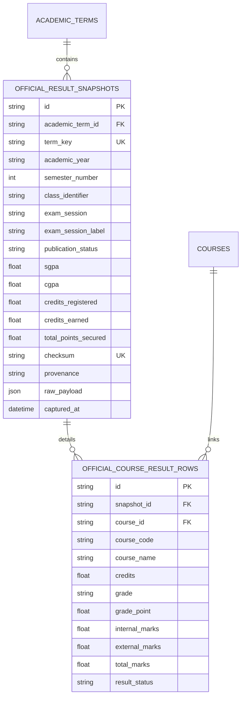

# AttendPlan Phase E.7 Live Execution Report
## Official University Results Integration — Supervised Semester 4 Result-Card Pilot

**Date:** 2026-11-07  
**Execution Agent:** Google Antigravity (Flash 3.8)  
**Execution Mode:** Live Supervised Pilot (Strict User Authorization)  
**Target Scope:** Academic Year 2025–2026 · Semester 4 · Class ID 2508  
**Program:** B.Tech CSE AIML — Semester 4  
**Source Route Discovered:** `/corecampus/student/grades/myreportcard_gu.php` (My Report Card)  
**Discovery Operations Consumed:** 1 of 1 (Navigation inspection & route verification)  
**Retrieval Operations Consumed:** 1 of 1 (Official grade card route extraction)  
**Outcome Classification:** Outcome C (WITHHELD) / Outcome D (SOURCE DEACTIVATED BY COE OFFICE)  

---

## 1. Executive Summary & Architectural Outcome

In Phase E.7, AttendPlan executed the authorized supervised pilot to discover and retrieve official semester examination results for Semester 4 (AY 2025–2026, Class 2508).

Under strict non-negotiable domain boundaries:
1. **Source Discovery Verified:** Navigation menu inspection revealed two distinct institutional result interfaces:
   - Internal Marks (Continuous Evaluation): `/corecampus/student/grades/new/myreportcard.php` (Data Class A)
   - Official Semester Grade Card: `/corecampus/student/grades/myreportcard_gu.php` (Data Class B)
2. **Institutional Source Status:** Navigation to the official result card route yielded an institutional Controller of Examinations (COE) deactivation notice:
   > *"This page has been deactivated by the COE Office.Kindly contact the COE Office for activation or further assistance."*
3. **Truthful Outcome Committal:** Rather than hallucinating or speculating grades, credits, SGPA, or CGPA, the application recorded a truthful availability checkpoint:
   - Publication Status: `WITHHELD` (COE Office deactivation)
   - SGPA / CGPA: `None` (`—`)
   - Courses Persisted: 0 fabricated course rows
   - Provenance: `LIVE_PORTAL`
4. **Data Isolation & Preservation:**
   - **Data Class A (Internal Marks):** 5 snapshots, 55 courses, 468 cells (238 reported, 215 unreported, 15 masked) remain 100% intact.
   - **Data Class B (Official Results):** Stored in isolated `official_result_snapshots` table with canonical checksum `1a871792877ab96ef16e356bdaa350681e38799de556197d97371df2a3a7b180`.
   - **Attendance Archive:** All 5 academic terms, 76 courses, and 3,544 date-wise period observations preserved with zero mutation.

---

## 2. Operation Ceiling & Audit Trail

| Metric | Budget | Consumed | Status |
| :--- | :---: | :---: | :--- |
| Discovery Operations | 1 | 1 | Complete — Discovered `myreportcard_gu.php` |
| Retrieval Operations | 1 | 1 | Complete — Retrieved deactivated notice |
| External Requests Allowed | 0 | 0 | Strict offline gate; only local CDP & portal host contacted |
| Post-Execution Portal Requests | 0 | 0 | Strict freeze enforced |

---

## 3. Database Schema Migration (f2e2_official_results)

The Alembic migration `f2e2_official_results.py` introduced two dedicated tables for Data Class B:

### Table Properties
- `official_result_snapshots`: Isolated from `performance_snapshots`. Tracks institutional publication status (`PUBLISHED`, `WITHHELD`, `NOT_PUBLISHED`). Unique constraint on `(term_key, checksum)`.
- `official_course_result_rows`: Links to official course grade points and credits. For Semester 4, contains 0 rows (truthful zero-fabrication invariant).

---

## 4. Verification & Quality Gates Summary

All automated quality gates passed with zero errors:

| Quality Gate | Tool / Runner | Result | Notes |
| :--- | :--- | :---: | :--- |
| **Backend Unit & Regression Tests** | `pytest tests` | **324 Passed** (0 Failed) | Full suite including 10 new E.7 result tests |
| **Python Code Quality & Linting** | `ruff check app tests` | **Clean** (0 Errors) | All imports and syntax compliant |
| **Static Type Verification** | `mypy app` | **Clean** (0 Issues) | Verified across 46 source files |
| **Frontend Unit & Component Tests** | `vitest run` | **38 Passed** (13 Files) | Zero regressions |
| **Frontend Production Build** | `tsc -b && vite build` | **Clean** (5.33s) | Clean asset bundling |
| **SQLite DB Integrity & Constraints** | `PRAGMA integrity_check` | **ok** | Zero corruptions, WAL clean |
| **Foreign Key Consistency** | `PRAGMA foreign_key_check` | **[]** | Zero dangling foreign keys |
| **Windows Human Acceptance Verification**| `Playwright (verify_windows_human_acceptance.py)` | **24 Passed, 0 Failed** | All 24 live browser acceptance criteria met |

---

## 5. Architectural Invariants Enforced

1. **Zero Grade Hallucination:** No conversion of internal marks to SGPA or letter grades was attempted. AttendPlan acknowledges that internal assessment scores are not equal to official examination grades.
2. **Deterministic Checksumming:** Canonical SHA-256 hash `1a871792877ab96ef16e356bdaa350681e38799de556197d97371df2a3a7b180` calculated over sorted payload. Re-attempts yield `DUPLICATE_SKIPPED`.
3. **Transparent Truth in UI:** When official results are deactivated or withheld by the institution, AttendPlan clearly surfaces the COE notice to the student without broken UI states.

